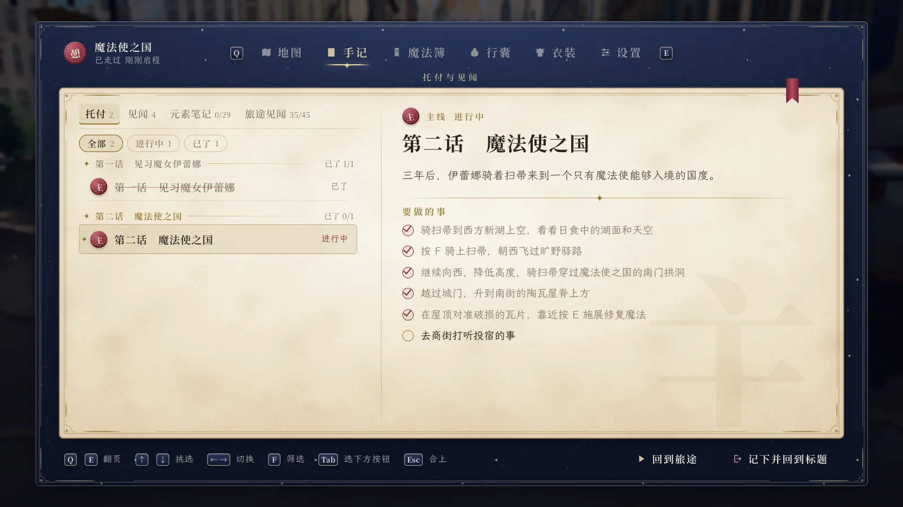

[简体中文](README.md)

# Wandering Witch · A Broom Journey


A free, third-person fan game of the first two episodes of the anime *Wandering Witch: The Journey of Elaina* (魔女之旅). You play Elaina: you leave the desk in your room, learn magic from Fran in the forest, and then fly west on your broom until the City of Magic rises out of the plain. The dialogue is written for the game, and the whole road is one open map you can cross in about five minutes of ordinary flight.

**[Play in your browser](https://weikezhang.cn/majo-no-tabitabi/)** · Simplified Chinese · keyboard and mouse on a computer, touch on phones and tablets held sideways. The first visit downloads the game; progress is saved in that browser. Choose 「踏上旅途」, walk to the desk and press **E** to open the travel journal.

This is an unofficial, non-profit project made by a fan. It has no connection with the rights holders of the original work.

## What's new in 2.0

- **An original score**: 13 new tracks built on two themes, with seamless loops; fights, bosses and duels add a hotter layer as more foes join.
- **A travel-journal interface**: entry stamps, diary-style narration, a passport map of the places you've been and crest gauges, with data structures ready for twelve episodes.
- **Tougher, better-looking fights**: foes wind up before they strike, timed dodges and guards open them to a counter, broken posture staggers them, and a nearly beaten foe rallies. Named elites, page guardians and Fran's replay fight in phases and take a skilled player a few minutes.
- **Learn to fight by fighting**: Fran's first spar is the combat tutorial; beam clashes, parries and charged-form combos are taught at the first page trial; Elaina's journal teaches everything else the first time you need it.
- **Spell tiers**: you start with small forms only and earn each charged form at one of six page trials in the wilds by solving its seal and beating its guardian.
- **Climbing and swimming**: cliffs, rock faces and house walls are climbable and water is swimmable, all on one stamina ring shared with sprinting and gliding.
- **Star thread and back-light**: fell trees with magic, lift logs on the star thread, turn them, tie them into rafts and rig a sail; the back-light rewinds damage, so felled trees stand up, broken stone closes and scorched ground turns green.
- **A hand-sculpted world**: the City of Magic's roofs, windows, gate, market, cathedral and five house types, with chimney smoke, laundry lines, cats and pigeons; the hometown houses, countryside stone and windmills, landmarks, trial grounds, foes and townsfolk are all re-sculpted.
- **Broom wakes**: low flight lays a recovering swath through the meadow, lifts petals and grass and throws up spray on the lake; the gold light shows only while boosting. Cruise is 15 m/s and boost 26 m/s, and dives trade height for speed.

## The two episodes

- **Episode 1 · The Apprentice Witch Elaina.** From home to Fran's cottage in the forest, wind magic in the clearing, and Fran's trial: watch her wand tip and raise your guard as the bolt arrives to send it back. Then the naming, the brooch, and goodbye to your mother.
- **Episode 2 · The Country of Mages.** West across Starscar Lake, through the wild country and over the high pass, and in through the arch of the great south gate. Meet Saya on a rooftop, mend the broken tiles, find the inn, and coach her through three flying rings. The parting at the gate is followed by an epilogue and the credits; after that the map stays open, and Fran waits in the clearing for a rematch.

Fran's meteor, the lake it leaves behind and the eclipse over the water on the way west are additions made for this adaptation.


## What you can do

### Duel like the anime


Casts draw layered magic circles at the wand and under your feet, a guard raised at the last moment flares into a starburst and reflects the spell, and the decisive beats slow down for a moment. Fran's first spar doubles as the combat tutorial; replaying it after the story adds a harder fourth movement. The east grassland is gentle; the western wilds and the high pass have camps, five named elites and riders who attack from the air. Wolves, mud blobs, stone guardians, ember snakes, frost stags and rogue mages each need a different answer: an elemental ward breaks only to the element that counters it, posture gauges can be broken, and each attack leaves an opening to punish.

### Combine the elements


Elements change materials, elements change each other, and materials never change one another directly. Lightning in a puddle charges it, ice freezes it into a sheet, fire boils it into a cloud of steam, earth churns it into mud. Your own spells fuse: fire shot into your tornado makes a fire tornado, thunder in your rain cloud makes a storm that strikes the foes beneath it, ice in it turns the rain to hail. Each of the 29 combinations is written into the journal's 「元素笔记」 page the first time you find it.

### The land remembers


Fire and lightning leave scorched pits, a rock pillar heaves up a mound, a meteor digs a crater, and trees fall away from the blast. All of it is saved and is still there when you come back. The land heals on the game clock: the scorch fades in about four minutes, the grass grows back in two and a half to six, burnt trees put out new leaves after eight, and a felled tree's stump sprouts a sapling after twenty minutes that is full grown at thirty. The pits stay, and grass slowly covers their floor. Towns, your home and the story places are protected.

### Fly into the vertical City of Magic


The city fills its whole plateau, and a skirt of mist hangs below its walls. The gate arch is 22.5 m high and its towers 92 m. The streets are dim canyons between tall houses, and life happens up high: around a thousand balconies, roof pads and footbridges are real platforms you can land on, and the sky is full of witches hopping between balconies, streaming along the sky lanes and circling the spires. The raised inner city holds the cathedral with its rose window. Once the roof is mended, the inn's counter sells bread and growth items for stardust.

### Discover the open country


The countryside has 47 original landmarks, laid out so that something new comes into view every few seconds of flight. 48 stray stars glint on tower tops, windmill caps, under bridges and on the highest peaks; every six bring a reward and a line from 「漏星魔女的手记」, the notes of the witch who let them slip. 17 landmark puzzles are solved only by element rules: light a beacon, burn a bramble, shatter a rockfall, freeze a pool to stop a drifting chest, wet thirteen standing stones and charge them with one strike, spin a wind wheel, chase a sky lantern you warmed with fire. Three ring courses hand out medals, and cairns and lookouts mark nearby stars on the map. Everything you find is listed on the map and on the journal's 「旅途见闻」 page.

<p>
  
  
</p>

### Change clothes


The 「衣装」 page has four outfits: her everyday clothes, the witch's robe and two swimsuits. The everyday clothes and the robe are yours to choose after the naming. Elaina is only fourteen or fifteen in episode 1, so the swimsuits open only after both episodes are finished. While an episode is running, the story dresses her for its scenes.

### Light and weather


The default look is soft and airy: restrained colours, lifted shadows, a pale blue distance. The original vivid look is one switch away in the settings. The sun stays low enough for long shadows and warm side light. Along the road it is clear about 30 % of the time, under fair-weather cumulus about 40 %, cloudy about 20 % and showery about 10 %; cloud shadows drift over the hills and sunbeams break through the gaps. The cinematic touches (slow motion, camera cuts, screen flashes) and the screen shake each have their own switch in the settings.

### Play on a phone


Hold the phone or tablet sideways. The left half of the screen is a move stick, dragging on the right half turns the camera, and the buttons on the right change as you walk, fly or fight. Button size, opacity and camera speed are in the settings. Phones start on the light quality tier.

## Controls

| Action | Keyboard and mouse |
| --- | --- |
| Move, look around | W A S D, mouse |
| Examine or talk, advance dialogue | E, Enter |
| Summon or dismiss the broom | F |
| On the broom: climb, descend, boost | Space, C, Shift |
| On foot: jump, sprint | Space, Shift |
| Pick a spell | number keys, or hold Tab for the wheel |
| Cast | right mouse button; hold and release for the charged form once you have it |
| Magic bolt | left mouse button (hold to keep firing) |
| Dodge, guard | Q, R (hold R; raise it as a spell arrives to reflect it) |
| Lock on | middle mouse button or T |
| Eat bread | X |
| Journal, map, spell book, pause | J, M, B, Esc |
| Climb | walk into a rock face or wall to grab it; Space to leap up, C to let go |
| Swim | Shift for a fast stroke, Q for a big pull; F calls the broom out of the water |
| Star thread (once learned) | Z draws the thread, left button catches or sets down; set a log against another to tie a star knot, right button unties |
| Back-light (once learned) | G lights it; aim at something broken and press the left button |

## Run it locally

You need Node.js 22.12 or newer and a desktop browser with WebGL 2.

```sh
git clone https://github.com/shoal-rat/majo-no-tabitabi.git
cd majo-no-tabitabi
npm ci
npm run serve
```

Open `http://127.0.0.1:8751/`. The first start builds the terrain data on your machine. The dev server rebuilds the game whenever you reload the page. Saves belong to the browser and the address, so keep using the same one.

The normal address picks a quality tier for your device and scales the render resolution when the frame rate drops. To fix them, add parameters: `?quality=low`, `med` or `high`, and `dynres=0` to turn the resolution scaling off. `http://127.0.0.1:8751/?quality=high&dynres=0` shows cloud shadows, reflections and the broom's wake at their best.

## Build and package

`npm run release` writes a static build to `dist/`. Upload the whole folder to any static web server.

On macOS you can also build an Electron app. After `npm ci`, install the desktop dependencies and package:

```sh
npm ci --prefix desktop
npm run package:mac
```

The script launches the finished app once to check it. The app is written to `release/魔女之旅-darwin-<arch>/魔女之旅.app`.

## Where to change things

The game is plain JavaScript with Three.js and Rapier. [docs/JOURNEY.md](docs/JOURNEY.md) is the main design document: the map, the systems, their rules and the tests. Every string the player sees lives in `src/locales/zh-CN/`, never in code.

| To change | Start here |
| --- | --- |
| Story steps and what completes them | [src/story/questdefs.js](src/story/questdefs.js) |
| Dialogue and quest text | [src/locales/zh-CN/story.dlg.main.js](src/locales/zh-CN/story.dlg.main.js) · [story.quests.js](src/locales/zh-CN/story.quests.js) |
| Fran's trial and her meteor | [src/story/fran-spar.js](src/story/fran-spar.js) · [fran-meteor.js](src/story/fran-meteor.js) |
| Route, road and story anchors | [src/data/journey-map.js](src/data/journey-map.js) |
| The City of Magic and its life | [src/data/bellcrown.js](src/data/bellcrown.js) (`CITY_LIFE`) · [src/world/builders/mage-city.js](src/world/builders/mage-city.js) · [bellcrown.js](src/world/builders/bellcrown.js) · [src/world/life/](src/world/life/) |
| Landmarks | [src/data/landmarks.js](src/data/landmarks.js) |
| Stray stars, puzzles, ring courses | [src/data/wilds.js](src/data/wilds.js) · [src/gameplay/wilds.js](src/gameplay/wilds.js) |
| Elements, combinations, spell fusions | [src/elements/](src/elements/) · [src/spells/fusions.js](src/spells/fusions.js) |
| Monsters and combat | [src/combat/](src/combat/) |
| Duel effects and magic circles | [src/fx/duel.js](src/fx/duel.js) · [src/fx/circles.js](src/fx/circles.js) |
| Terrain destruction and healing | [src/world/destruction.js](src/world/destruction.js) |
| Colour look, sun, sky | [src/render/post.js](src/render/post.js) (`GRADES`, `LOOKS`) · [src/world/sky.js](src/world/sky.js) · [src/world/veil.js](src/world/veil.js) |
| Weather and clouds | [src/world/journey-weather.js](src/world/journey-weather.js) · [src/render/cloud-field.js](src/render/cloud-field.js) |
| Wardrobe | [src/data/outfits.js](src/data/outfits.js) · [src/ui/wardrobe.js](src/ui/wardrobe.js) |
| Touch controls | [src/ui/touch.js](src/ui/touch.js) |

## Tests

After a gameplay change, run the acceptance scripts with a local Chrome, Chromium or Edge (set `CHROME_BIN` if it is installed somewhere unusual). They use a throwaway headless browser profile and never touch your save.

```sh
node tools/acceptance/journey-story.mjs          # both episodes, a real save reload, both outcomes of Fran's trial, credits, rematch
node tools/acceptance/journey-flight.mjs         # across the map: weather, sun, windmills, a player-made crater through save and load
node tools/acceptance/journey-cloud-weather.mjs  # cloud cover along the weather fronts, reproduced from saved time
node tools/acceptance/journey-city-clouds.mjs    # the city wall hidden by cloud and revealed again, sunbeams
node tools/acceptance/journey-eclipse.mjs        # the eclipse over the lake and the reflections on the water
node tools/acceptance/journey-activities.mjs     # every puzzle kind solved with real spells, stars, a ring course, save round trip
node tools/acceptance/journey-errands.mjs        # all five roadside errands through dialogue, flight and spells, save round trips
node tools/check-i18n.mjs src                    # no player-visible text hard-coded in the source
node tools/dead-code.mjs                         # source files that never reach the game bundle
```

`node tools/play.mjs --name x --script f.js [--mobile --size 844x390]` runs the game headless with your own script, takes screenshots and simulates touch. The GIFs on this page were recorded frame by frame from the game with [tools/trailer/capture.mjs](tools/trailer/README.md); their shots are in [tools/trailer/shots/readme/](tools/trailer/shots/readme/).

## Issues and pull requests

Bug reports are welcome in the pinned **[feedback thread #7](https://github.com/shoal-rat/majo-no-tabitabi/issues/7)**: getting stuck, clipping, lighting or performance problems. For a larger problem, open a separate issue with the bug-report template. Please include the current journal objective, where you were, what you did, your browser and the quality tier, and a screenshot when something looks wrong.

Want to change something? Open an issue, claim it with a `/claim` comment, then open a pull request; [CONTRIBUTING.md](CONTRIBUTING.md) has the details.

For changes, open a pull request from your own branch. Every pull request is built and its character models are checked automatically. If an AI coding agent helps you, have it read [AGENTS.md](AGENTS.md) first: it lists the conventions that must not change and the checks to run.

## Licence and assets

The project's original code is released under the [MIT licence](LICENSE): you may study, change, share and also use it commercially.

The title, characters and setting of *Wandering Witch: The Journey of Elaina* belong to their rights holders. Game assets keep their own licences. Generated art and CC0 assets made for the project need no attribution. Authors, sources and licences of third-party models, music, sound and fonts are collected in [CREDITS.md](CREDITS.md) and, item by item, in [assets/manifest.json](assets/manifest.json), so they can travel with any redistribution.
