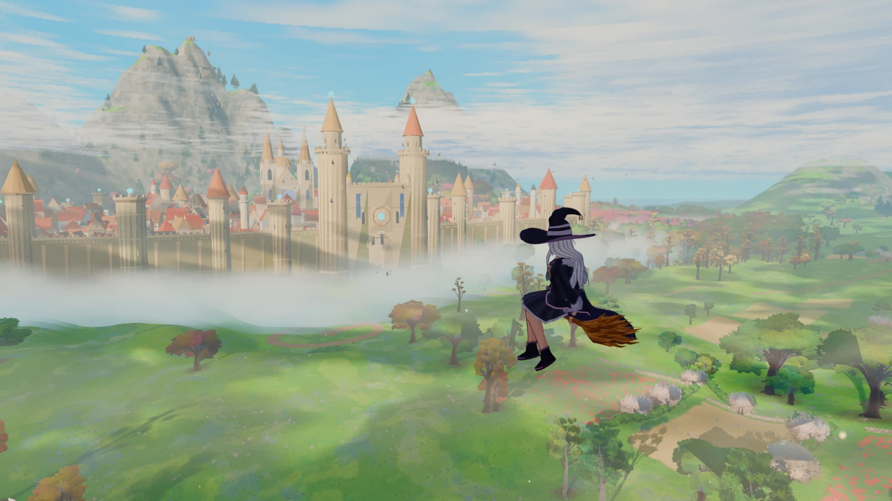
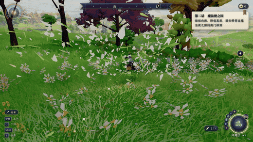
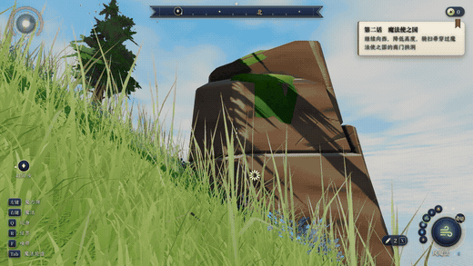
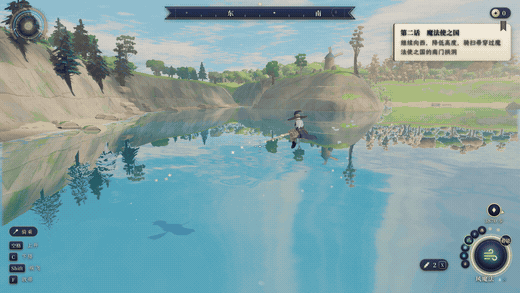
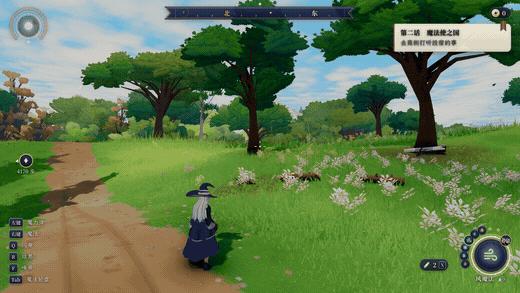
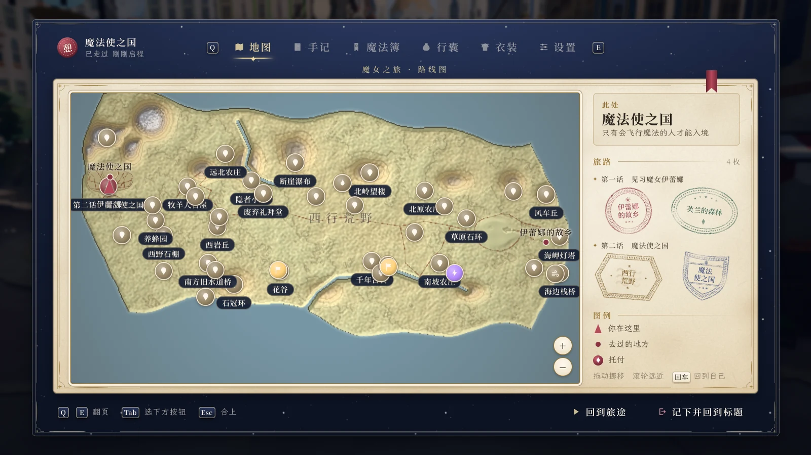
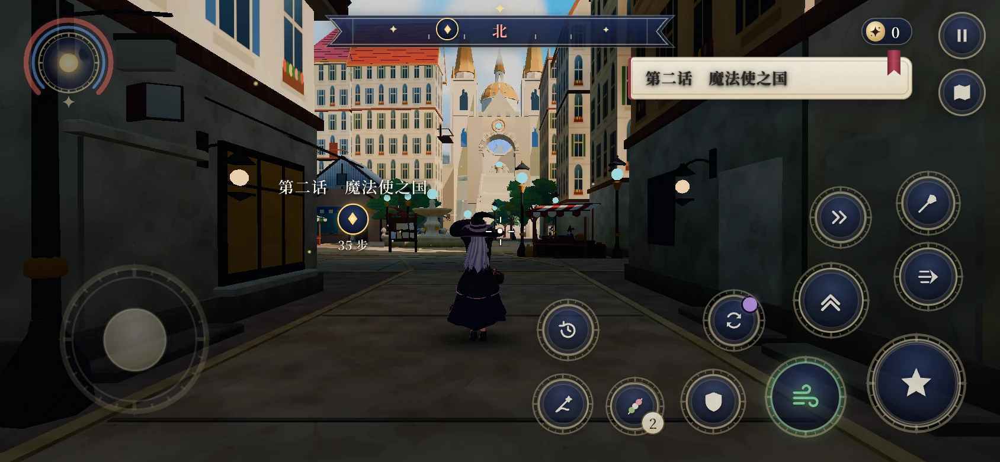

[简体中文](README.md)

# Wandering Witch · A Broom Journey



A free, third-person fan game of the first two episodes of the anime *Wandering Witch: The Journey of Elaina* (魔女之旅). You play Elaina: you leave the desk in your room, learn magic from Fran in the forest, and then fly west on your broom until the City of Magic rises out of the plain. The dialogue is written for the game. The whole road is one open map that you can fly, walk, climb and swim across, with monsters, trials and travellers who could use a hand along the way.

**[Play in your browser](https://weikezhang.cn/majo-no-tabitabi/)** · Simplified Chinese · keyboard and mouse on a computer, touch on phones and tablets held sideways. The first visit downloads the game; progress is saved in that browser. Choose 「踏上旅途」, walk to the desk and press E to open the travel journal.

This is an unofficial, non-profit project made by a fan. It has no connection with the rights holders of the original work.

## The two episodes

Episode 1, "Elaina the Apprentice Witch": walk from your hometown to the cottage in the forest and become Fran's pupil. While you help with her chores she shows you how to carry firewood on a thread of gold light; then you practise wind magic in the clearing and face Fran's trial. That bout is also the combat tutorial: lock-on, dodging, the guard, counter-attacks and answering a spell with the element that beats it are taught one at a time inside the fight. After it come the naming, the brooch and the goodbye to your mother.

Episode 2, "The Land of Mages": fly west over Starscar Lake, across the wilds and the high pass, and in through the arch of the south gate. Run into Saya on the rooftops, mend the roof tiles, find the inn, and help her practise flying through three rings. After the farewell at the city gate come the epilogue and the credits. Once you have finished, the map stays open to fly, and you can return to the forest clearing for a rematch with Fran that adds a harder fourth movement.

Fran's meteor, the lake it makes and the eclipse over the lake on the way west were added for this adaptation.


## What you can do

### Duels, and learning to fight by fighting


Foes wind up visibly before they strike, and once they start an attack they finish it unless they are staggered, shocked or frozen. Dodge or guard at the right moment and the attacker is left open for a counter; hitting it with different elements in turn breaks its posture; when it is nearly beaten it rallies and attacks faster. The eastern grassland has few monsters, while the western wilds and the high pass have camps, five named elites and ambushers who attack from broomback. Moor wolves, mud blobs, pass sentries, ember serpents, frost stags and bandit mages each need a different answer, and a foe with an elemental ward only takes damage from the element that counters it. Elites, page guardians and Fran's rematch fight in phases and take a skilled player a few minutes.

The combat tutorial is Fran's first bout. Beam clashes, parries, charging and tier-two combinations are taught at the first page trial you reach. Sprinting, the broom, eating bread, the spell wheel, the map and the rest are covered by Elaina's travel journal: it writes a short note the first time you need something, and crosses it off once you have done it.

### Magic and spell tiers


Fran only teaches the small, tier-one forms. You learn wind after reading the book at home, water, fire and ice after Fran's confession, and thunder and earth at the naming. The charged tier-two forms have to be found in the open country. Six page trials lie along the road west, each with a stone bearing an element's sigil and a mechanism that answers only that element. Wind makes a stone harp sing, lightning strikes an iron rod, fire lights five candles, earth lifts a sunken lectern, water wakes a dry lily bud and ice stops a falling spring. Only a witch who has been named can open the seal. When it opens the guardian wakes, and its elemental ward breaks only to the element that counters it. Win, pick up the page it drops, and you have that element's tier-two form.

The element system has three rules: elements change materials, elements change elements, and materials never react with each other directly. Thunder in a puddle electrifies it, ice freezes it into a sheet, fire boils it into steam and earth churns it into mud. Your own spells can also fuse: fire into your tornado makes a fire whirl, thunder into a rain cloud makes a storm cloud that strikes the enemies below, and ice into it brings hail. There are 29 combinations, and each one goes into the journal's 「元素笔记」 (Element Notes) the first time you find it.

Fire and thunder blast scorched craters, earth pillars raise mounds, meteors leave craters and trees fall away from the blast. All of it is saved, and the land heals on game time: scorch marks fade in about four minutes, grass grows back in two and a half to six minutes, and a fallen tree sends up a sapling from its stump after twenty minutes. Towns, the hometown and story locations cannot be damaged.

### Getting around: broom, climbing, swimming



Press F to call the broom. It cruises at 15 m/s, and holding Shift boosts it to 26 m/s at a cost in mana; diving trades height for speed. Fly low and the broom presses a trail through the flower meadows that slowly stands back up, throwing petals and grass into the air; skim the lake and it kicks up spray. The gold light in its wake only shows while you boost.



Rock faces, cliffs, boulders and house walls are all climbable: walk into one and she takes hold. Space leaps upward and Q lets go. At the top she pulls herself over. The eaves of a pitched roof give no footing, so in the city the places to stand are still the balconies, rooftop pads and footbridges, and the broom is how you get between them. Hold C while running down a steep slope to slide all the way down.



Deep water is swimmable: hold Shift to swim fast, and Q makes a strong stroke. Holding C while skimming the water on the broom dives you straight in. Sprinting, climbing and fast swimming share the ring of twelve petals by her shoulder, her stamina: when it runs out the ring turns rose and has to refill completely before you can run or climb again, and running out in deep water makes her sink until the water carries her back to the bank. The broom costs no stamina and can be called from the water at any time. Three broken lantern posts stand beside the road in episode 2; each one you mend adds a level of stamina.

### Craft: the star thread, rafts and the back-light


The star thread 「牵星线」 is Fran's: a witch does not carry firewood by hand. Press Z to draw a fine gold thread from the tip of the wand, aim at a log, plank, crate, barrel, ladder or sail and left-click to catch it, then carry it where you want it. The mouse wheel pushes it out and pulls it in, and holding R while moving the mouse turns it. Trees felled by magic become logs you can carry. Lay a part against another one and small four-pointed stars, star knots 「结星」, light up where they touch; let go and they are tied, and a right-click unties them. Tied parts float, so you can build bridges, ramps and rafts; a raft with a sail catches the wind, and a gust of wind magic into the sail sends it off.



The back-light 「溯光」 comes to her while she mends the roof tiles in the City of Magic. Press G to light it, aim at something damaged and left-click, and its history runs backwards: logs fly back into the trunk and the fallen tree stands up again, shards close into the rock, scorched ground loses its black and the grass stands up, a crater's earth flows back in, and something broken reassembles. What she restores is removed from the save; whatever she leaves alone heals at its own pace as before.

### The City of Magic and the open country


The City of Magic covers its whole plateau. The gate arch is 22.5 m high and the gate towers 92 m. The streets are dim canyons between tall houses and life happens up high: nearly a thousand balconies, rooftop pads and footbridges are places to land, and the sky is full of witches on brooms. The houses are sculpted piece by piece, with pan-tile and slate roofs, dormers and chimneys, windows with shutters and flower boxes, shop fronts with signs for their trades, arcades, stepped stone gables, half-timbered storeys, corner turrets and tower-houses. The market stalls have keepers, there are pigeons in the squares and cats on the roofs, laundry hangs across the side streets, chimneys smoke, and windows light up one by one as the day dims. On the raised inner city stands the cathedral with its rose window. After you mend the roof tiles, the inn counter sells bread and growth items for stardust.

The hometown's houses, the rocks and walls of the open country, the windmill, the landmarks, the page-trial stones and mechanisms, the monsters and the people on the road were all re-sculpted with the same tools.

The open country has 47 original landmarks, placed so that on the broom something new comes into view every few seconds. 48 stray stars hide on tower tops, windmill caps, under bridges and on the highest peaks; every 6 bring a reward and a line from 「漏星魔女的手记」 (Notes of the Star-Spilling Witch). 17 landmark puzzles can only be solved by the element rules, such as lighting a beacon, freezing a pool to hold a drifting chest in place, or wetting thirteen standing stones and lighting them all with one bolt of thunder. Three flight ring courses award medals by time. Along the road are five small stories of travellers: delivering a letter, chasing a hat the wind took, lighting a shepherd's stove, freezing a river so a pumpkin cart can cross, and reading the star notes aloud to the witch at a roadside shrine.

Along the route the weather is about 30% clear, 40% clear with cumulus, 20% cloudy and 10% showers; cloud shadows sweep across the hills and light shafts fall through the gaps. The default look is soft and clear, and the settings can switch back to the vivid original. Slow motion, camera cuts, screen flashes and camera shake can each be turned off.

### Music, interface and phones

<p>
  
  
</p>

The music is an original score of 13 tracks written for this game, all grown from two themes: one for the journey, which follows Elaina, and one for magic, which belongs to Fran, the City of Magic and the page trials. The scores live in the repository as data and are rendered note by note by a synthesiser in the repository, without samples. The fight, elite and duel tracks each carry a hotter layer that rises when foes crowd in, when a foe rallies, or when your health runs low.

The interface is made to look like a travel journal. Entering a new country presses an entry stamp, narration appears like a line written in a diary, the map page prints the places you have been as passport stamps, and the crest at the top left shows life and mana as two arcs. When nothing is happening for a while, the whole interface goes quiet. The wardrobe page has everyday clothes, the witch's robe and two swimsuits; the swimsuits open only after both episodes are finished. Chapters, countries and stamps are all read from one episode registry, ready for the game to grow to twelve episodes.



Hold phones and tablets sideways. The left half of the screen is the stick, dragging on the right half turns the camera, and the buttons on the right change for walking, the broom, fighting and craft. Button size, opacity and look speed can be adjusted in the settings. Phones start on a quality tier made for phones.

## Controls

| Action | Keyboard and mouse |
| --- | --- |
| Move, look around | W A S D, mouse |
| Inspect or talk, advance dialogue | E, Enter |
| Call or put away the broom | F |
| On the broom: climb, descend, boost | Space, C, Shift |
| On foot: jump, sprint | Space, Shift |
| Choose a spell | number keys, or hold Tab for the wheel |
| Cast | right mouse button; once you know a tier-two form, hold to charge and release |
| Magic bullet | left mouse button (hold for rapid fire) |
| Dodge, guard | Q, R (hold R to raise a shield; raise it just as a spell arrives to send it back) |
| Beam clash | when a beam comes at you, hold R into it and mash the left mouse button |
| Lock on | middle mouse button or T |
| Eat bread | X |
| Journal, map, spellbook, pause | J, M, B, Esc |
| Climb | walk into a rock face or wall to take hold; Space leaps upward, Q lets go |
| Slide | hold C while running down a steep slope |
| Swim | Shift swims fast, Q makes a strong stroke, F calls the broom out of the water; hold C while skimming the water on the broom to dive in |
| Star thread (once learned) | Z draws the thread, left-click catches or lets go; the wheel pushes and pulls, hold R and move the mouse to turn; let go against another part to tie a star knot, right-click unties |
| Back-light (once learned) | G lights it, aim at something damaged and left-click |

## Run it locally

You need Node.js 22.12 or newer and a desktop browser with WebGL 2.

```sh
git clone https://github.com/shoal-rat/majo-no-tabitabi.git
cd majo-no-tabitabi
npm ci
npm run serve
```

Open `http://127.0.0.1:8751/`. The first start builds the terrain data on your machine. The dev server rebuilds every time you reload the page. Saves belong to the browser and the address, so use the same one next time.

The normal entry picks a quality tier for your device and lowers the render resolution when the frame rate drops. To pin them, add `?quality=low`, `med` or `high`, and `dynres=0` to turn off the resolution scaling. `http://127.0.0.1:8751/?quality=high&dynres=0` shows cloud shadows, water reflections and the broom's wake on the water most clearly.

## Build and package

`npm run release` writes a static build to `dist/`; put the whole folder on any static web server.

On macOS you can also package an Electron app. After the `npm ci` above, install the desktop dependencies and package:

```sh
npm ci --prefix desktop
npm run package:mac
```

The packaging script launches the finished app once to check it. The app is at `release/魔女之旅-darwin-<arch>/魔女之旅.app`.

## Where to start changing things

The game is written in JavaScript with Three.js and Rapier. The main document is [docs/JOURNEY.md](docs/JOURNEY.md): the map, each system's rules and how to test them. All player-visible text lives in `src/locales/zh-CN/` and never in code.

| What you want to change | Start here |
| --- | --- |
| Story steps and their conditions | [src/story/questdefs.js](src/story/questdefs.js) |
| Dialogue and quest text | [src/locales/zh-CN/story.dlg.main.js](src/locales/zh-CN/story.dlg.main.js) · [story.quests.js](src/locales/zh-CN/story.quests.js) |
| Fran's trial and the combat tutorial | [src/story/fran-spar.js](src/story/fran-spar.js) · [spar-lessons.js](src/story/spar-lessons.js) |
| Journal notes shown the first time something is needed | [src/gameplay/onboarding.js](src/gameplay/onboarding.js) |
| Route, main road and story anchors | [src/data/journey-map.js](src/data/journey-map.js) |
| Episode registry (chapters, countries, stamps) | [src/data/episodes.js](src/data/episodes.js); the steps for adding an episode are in "Adding an episode" in [docs/api/ui.md](docs/api/ui.md) |
| The City of Magic and city life | [src/data/bellcrown.js](src/data/bellcrown.js) (`CITY_LIFE`) · [src/world/builders/mage-city.js](src/world/builders/mage-city.js) · [src/world/life/](src/world/life/) |
| Landmarks, stray stars, puzzles, ring courses | [src/data/landmarks.js](src/data/landmarks.js) · [src/data/wilds.js](src/data/wilds.js) · [src/gameplay/wilds.js](src/gameplay/wilds.js) |
| Page trials | [src/gameplay/wilds-pages.js](src/gameplay/wilds-pages.js) · `PAGE_SITES` in `src/data/wilds.js` |
| Elements, combinations, spell fusions | [src/elements/](src/elements/) · [src/spells/fusions.js](src/spells/fusions.js) |
| Monsters and the pace of fights | [src/combat/](src/combat/) · [src/combat/pacing.js](src/combat/pacing.js) |
| Climbing, swimming and stamina | [src/player/climb.js](src/player/climb.js) · [src/player/stamina.js](src/player/stamina.js) |
| Star thread, star knots, back-light | [src/craft/](src/craft/) · [src/data/craft.js](src/data/craft.js) (catchable parts, mending sites, numbers) · [src/locales/zh-CN/craft.js](src/locales/zh-CN/craft.js) |
| Terrain destruction and healing | [src/world/destruction.js](src/world/destruction.js) |
| Music | [tools/music/](tools/music/README.md): the scores are in `cues/`, render one with `node tools/music/render.mjs <name>` |
| Sculpted models | [tools/sculpt/](tools/sculpt/README.md): shape code turned into GLBs with LODs. Add `?sculpt=0` to the game's address to see the old objects they replaced, `?sculpt=all` to turn all of them on, or `?sculpt=type,type` for just those types |
| Colour look, sun, sky, weather | [src/render/post.js](src/render/post.js) (`GRADES`, `LOOKS`) · [src/world/sky.js](src/world/sky.js) · [src/world/journey-weather.js](src/world/journey-weather.js) |
| Wardrobe | [src/data/outfits.js](src/data/outfits.js) · [src/ui/wardrobe.js](src/ui/wardrobe.js) |
| Touch controls | [src/ui/touch.js](src/ui/touch.js) |

## Tests

After a gameplay change, run the acceptance scripts with a local Chrome, Chromium or Edge (set `CHROME_BIN` if it is installed somewhere unusual). They use a throwaway headless browser profile and never touch your save.

```sh
node tools/acceptance/journey-story.mjs          # both episodes, a real save reload, both outcomes of Fran's trial, credits, rematch
node tools/acceptance/journey-flight.mjs         # across the map: weather, sun, windmills, a player-made crater through save and load
node tools/acceptance/journey-cloud-weather.mjs  # cloud cover along the weather fronts, reproduced from saved time
node tools/acceptance/journey-cloud-flight.mjs   # the broom climbs into a daytime cloud, looks down, and descends into it again
node tools/acceptance/journey-city-clouds.mjs    # the city wall hidden by cloud and revealed again, sunbeams
node tools/acceptance/journey-eclipse.mjs        # the eclipse over the lake and the reflections on the water
node tools/acceptance/journey-activities.mjs     # every puzzle kind solved with real spells, stars, a ring course, the six page trials, save round trip
node tools/acceptance/journey-errands.mjs        # all five roadside errands through dialogue, flight and spells, save round trips
node tools/acceptance/broom-wake.mjs             # no browser: the broom's flight forces and its wake
node tools/acceptance/meadow-wake.mjs            # no browser: the trail pressed into the meadow and the petals it lifts
node tools/acceptance/pressure-waves.mjs         # no browser: the wake and ripples on the water
node tools/check-i18n.mjs src                    # no player-visible text hard-coded in the source
node tools/dead-code.mjs                         # source files that never reach the game bundle
```

`node tools/play.mjs --name x --script f.js [--mobile --size 844x390]` runs the game headless with your own script, takes screenshots and simulates touch. The GIFs on this page were recorded frame by frame from the game with [tools/trailer/capture.mjs](tools/trailer/README.md); their shots are in [tools/trailer/shots/readme/](tools/trailer/shots/readme/).

## Feedback and contributing

Bug reports are welcome in the pinned **[feedback thread #7](https://github.com/shoal-rat/majo-no-tabitabi/issues/7)**: getting stuck, clipping, lighting or performance problems. For a larger problem, open a separate issue with the bug-report template. Please include the current journal objective, where you were, what you did, your browser and the quality tier, and an in-game screenshot when something looks wrong.

To change something yourself: first open an issue with the Proposal template, saying what you want to change, what a player would notice, and whether it shortens the journey or makes the game easier; then claim the issue with a `/claim` comment; then open a pull request from your own branch with `Closes #<issue>` on the first line. Every pull request is built automatically, and its character models and claim are checked. The full rules are in [CONTRIBUTING.md](CONTRIBUTING.md). If an AI coding agent helps you, have it read [AGENTS.md](AGENTS.md) first: it lists the conventions that must not change and the checks to run.

## Licence and assets

The project's original code is released under the [MIT licence](LICENSE): you may study, change, share and also use it commercially.

The title, characters and setting of *Wandering Witch: The Journey of Elaina* belong to their rights holders. Game assets keep their own licences: third-party assets are CC0 or CC-BY only, and fonts are OFL. Art generated or sculpted for the project and CC0 assets need no attribution. The background music is the project's own original score. The way the broom leaves trails in grass and on water, and the petals and spray it throws up, are adapted from [Petalwake](https://github.com/jjcm/petalwake) (MIT). Authors, sources and licences are collected in [CREDITS.md](CREDITS.md) and, item by item, in [assets/manifest.json](assets/manifest.json), so they can travel with any redistribution.
