[English](README.en.md)

# 魔女之旅 · 骑帚旅行

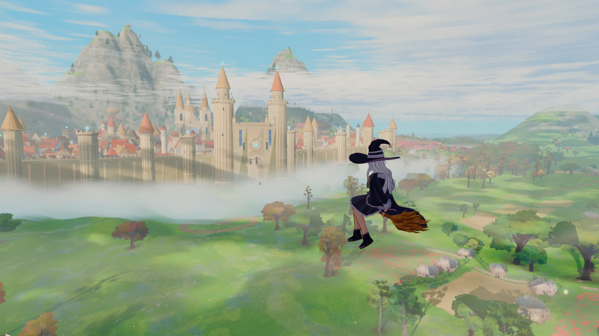

扮演伊蕾娜，从故乡的书桌出发，到森林里向芙兰学魔法，再骑扫帚一路向西，直到魔法使之国从原野上升起。这款免费的第三人称同人游戏改编自动画前两话，对白为游戏重新编写。整段旅程是一张连在一起的大地图，可以飞，可以走，也可以攀岩、游泳，路上有魔物、试炼和需要帮一把的旅人。

**[在浏览器开始旅行](https://weikezhang.cn/majo-no-tabitabi/)** · 简体中文 · 电脑用键鼠，手机和平板横屏触屏。第一次打开需要下载游戏资源，进度保存在当前浏览器。选择「踏上旅途」，走到书桌前按 E 翻开旅行记。

本项目是爱好者制作的非官方、非营利同人游戏，与原作权利方没有关系。

## 两话的行程

第一话「见习魔女伊蕾娜」：从故乡走到森林小屋拜师。帮芙兰干杂活时，她会教你用一缕金线搬柴；之后在空地上练风魔法，再接受芙兰的试炼。这场比试也是战斗教学，锁定、闪身、举盾、反击、用相克的元素回敬对方，都在比试里一样一样学会。之后是授名、胸针，和母亲道别。

第二话「魔法使之国」：向西渡过星痕湖，穿过旷野、翻过高山口，从南城门的拱洞飞进城。在屋顶撞见沙耶，修好屋瓦，找到旅馆，再带她练习穿过三道飞行环。城门道别之后是尾声和片尾名单。通关后地图照样可以自由飞，也可以回林间空地找芙兰再比一场，这一场多出更难的第四阶段。

芙兰的陨石、它砸出的湖，以及西行渡湖时的日食，是这次改编新加的情节。


## 可以做些什么

### 斗法，在打斗里学打斗

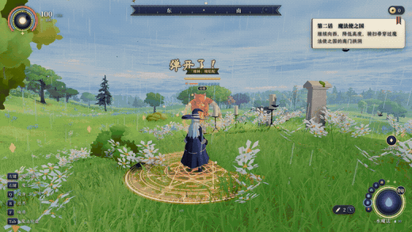

敌人出招前有看得见的起手动作，一旦出手就会打完，除非被打出硬直、电麻或冻住。看准时机闪过或举盾，对方会露出破绽，正好反击；交替用不同元素打上去能打崩它的架势；血量见底时它会背水一战，出手更快。东部草原魔物不多，西行荒野和高山口有营地、五个具名精英，还有骑扫帚从空中偷袭的人。荒原狼、泥沼团、隘口石卫、余烬蛇、霜角鹿和盗贼魔法使各有打法，带元素护盾的只怕克制它的元素。精英、试炼守护者和芙兰的重温比试都分阶段，熟练的人也要打上几分钟。

战斗教学就是芙兰的第一场比试。对波、弹反、蓄力和二阶组合，在你第一次走到的残页试炼里学。疾跑、扫帚、吃面包、魔法轮盘、地图这些，伊蕾娜的旅行手记会在第一次用得上时写一句提醒，你照着做了，这一条就划掉。

### 魔法与分阶


芙兰只教一阶的小式。读完家里的书会风，芙兰坦白之后会水、火、冰，授名时会雷和岩。蓄力放出的二阶大式要自己去野外拿：六处「残页试炼」沿着西行的路排开，每处有一块刻着元素纹章的石碑，旁边是只认这种元素的机关。风吹响石琴，雷落进铁杆，火点亮五支蜡烛，岩把沉下去的经台顶起来，水唤醒干枯的睡莲，冰冻住往下落的泉水。只有授过名的魔女能打开封印。封印一开，守护者醒来，它的元素护盾只有相克的元素打得破。打赢后拾起掉落的残页，就学会这一系的二阶。

元素的规则只有三条：元素改变物质，元素改变元素，物质之间不会直接起反应。雷打进水洼会让它带电，冰把它冻成冰面，火把它烧成蒸汽云，岩把它搅成泥沼。自己的法术还能融合：火打进自己的龙卷变成炎旋，雷劈进雨云变成朝下方敌人落雷的雷雨云，冰打进去就下起冰雹。一共 29 种组合，第一次发现时会记进手记的「元素笔记」。

火和雷会炸出焦坑，岩柱顶起土丘，陨石砸出陨坑，树木朝爆炸的反方向倒下。这些痕迹都写进存档，大地再按游戏时间慢慢长好：焦痕大约四分钟褪去，草两分半到六分钟长回来，倒下的树二十分钟后从树桩里冒出树苗。城镇、故乡和剧情地点不会被破坏。

### 走遍大地：扫帚、攀爬、游泳

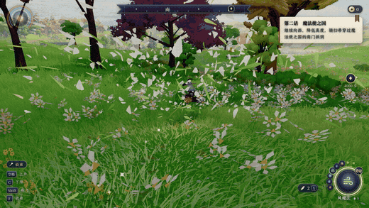

按 F 唤出扫帚。巡航每秒 15 米，按住 Shift 加速到每秒 26 米，加速耗魔力，俯冲能换来速度。贴着地面飞，扫帚会在花田里压出一道慢慢立起来的痕迹，卷起花瓣和草叶；掠过湖面会溅起水花。尾迹里的金光只在加速时出现。

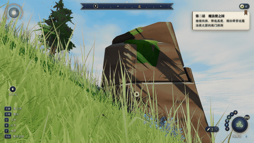

岩壁、悬崖、大石头和房子的外墙都能爬，走过去贴上就会抓住，空格向上一跃，Q 松手。爬到顶会翻上去。尖屋顶的屋檐上没有落脚的地方，所以在城里，能站的还是露台、屋顶平台和廊桥，扫帚才是在它们之间往来的路。顺着陡坡跑时按住 C，可以一路滑下去。

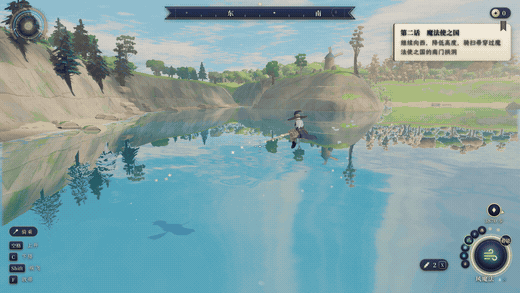

深水可以游，按住 Shift 快游，Q 划一大把。贴着水面飞时按住 C，会从扫帚上直接扎进水里。疾跑、攀爬和快游共用肩旁那圈十二瓣的「气力」花环：用完时花环变成浅红，要歇到满才能再跑再爬；在深水里耗尽会沉下去，被水推回岸边。扫帚不耗气力，在水里也能随时唤出来。第二话路边有三盏碎掉的灯笼柱，修好一盏，气力就多一级。

### 手艺：牵星线、木筏与溯光

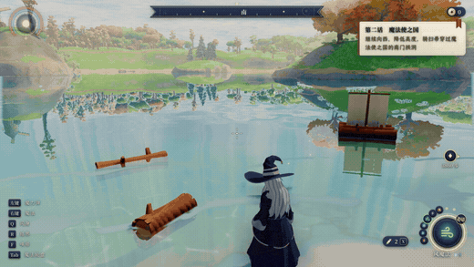

「牵星线」是芙兰教的：魔女搬柴不用手。按 Z 从杖尖牵出一缕金线，对准木头、木板、木箱、木桶、梯子或帆按左键牵住，再把它搬到想放的地方。滚轮推远拉近，按住 R 动鼠标能转动它。魔法打倒的树会变成能搬的木头。把它贴着另一块放下，接触处会亮起四角的小星「结星」，松手就系在一起，右键解开。系好的东西会浮在水上，可以搭桥、搭坡、扎木筏；挂了帆的木筏会吃风，朝帆吹一阵风魔法，它就开走了。

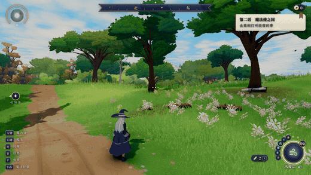

「溯光」是在魔法使之国修屋瓦时学会的。按 G 点亮，对准坏掉的东西按左键，它的来路会倒着流回去：木头飞回树干，倒下的树重新站起；碎石合拢；焦土褪去黑色，草重新立起来；陨坑的土流回原处；摔碎的东西拼回原样。修好的痕迹从存档里抹掉，没去管的地方，大地照样按自己的速度慢慢长好。

### 魔法使之国与旷野

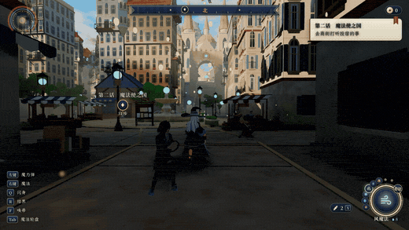

魔法使之国铺满了整座高台，城门拱洞高 22.5 米，城门塔高 92 米。街道是高楼夹出的幽暗峡谷，生活都在高处：近千个露台、屋顶平台和廊桥都能落脚，天上满是骑扫帚的魔女。房子是一件件雕出来的，有陶瓦和石板屋顶、老虎窗和烟囱，带百叶窗和花箱的窗户，按行当挂招牌的店面和拱廊，还有阶梯山墙的石屋、半木结构的楼、转角塔楼和塔楼住宅。集市的摊位有摊主，广场上有鸽子，屋顶上有猫，小巷上空横着晾衣绳，烟囱冒着烟，天暗下来窗户会一扇扇亮起。城中央抬高的内城上是带玫瑰窗的大教堂。修好屋瓦之后，旅馆柜台可以用星屑买面包和成长道具。

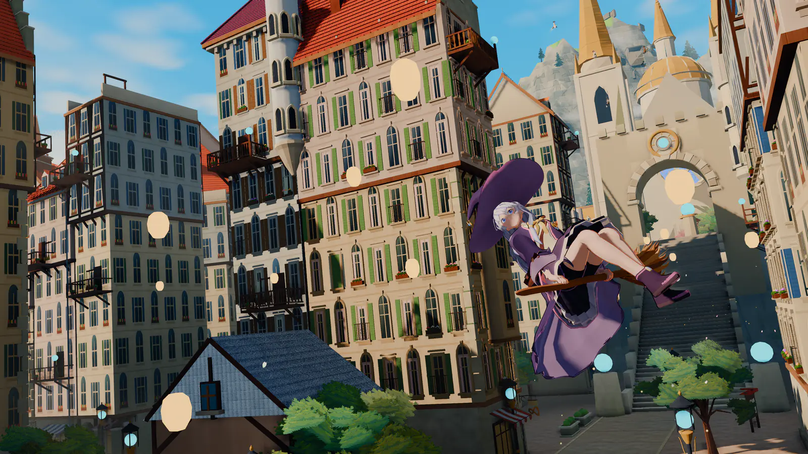

故乡的房屋、野外的岩石和石墙、风车、地标、试炼场的石碑和机关、魔物和路人，也都用同一套工具重新雕过。

原野上有 47 处原创地标，骑帚时每隔几秒就有新东西进入视野。48 颗「迷星」藏在塔顶、风车帽、桥洞下和最高的山顶上，每拾到 6 颗有奖励，还会浮现一句「漏星魔女的手记」。17 处地标机关只能用元素规则解开，比如点燃烽火台、冻住水潭留住漂走的匣子、淋湿十三块立石再用一道雷全部点亮。三条飞行环线按成绩发奖章。路边还有五段旅人的小事：送信、追被风吹走的帽子、给牧羊人生火、冻住河面让南瓜车过河、给路边神龛的魔女念星星的手记。

天气一路上大约三成晴、四成晴天积云、两成多云、一成阵雨，云影从山坡上掠过，云隙间落下光柱。默认是柔和通透的色调，设置里可以换回鲜艳的色调；慢动作、镜头切换、闪屏和画面震动都可以分别关掉。

### 音乐、界面与手机

<p>
  
  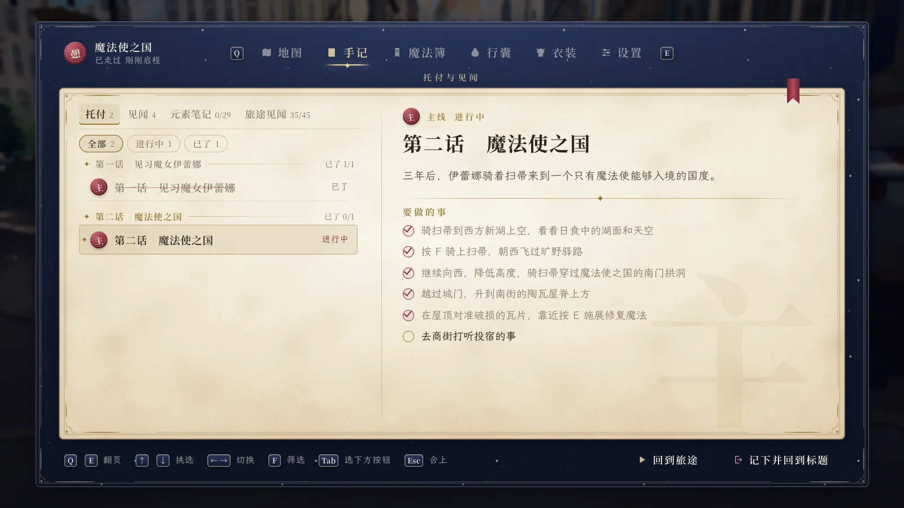
</p>

配乐是为这个游戏写的 13 首原创曲目，都从两条主题长出来：一条是旅途，跟着伊蕾娜走；一条是魔法，属于芙兰、魔法使之国和残页试炼。乐谱以数据形式写在仓库里，由仓库内的合成器逐音渲染，不用采样。战斗、精英和对决的曲子各带一层更激烈的声部，敌人围上来、有敌人背水一战、或者血量见底时，这层声部会升起来。

界面做成旅行手记的样子。进入新的国家会盖下入境印章，旁白像写在日记里的一行字，地图页把去过的地方印成护照印章，左上角的徽章用两道弧显示生命和魔力，一阵子没事，整套界面就安静下来。「衣装」页有日常服、魔女服和两套水着，水着要两话都通关才开放。章节、国家和印章都从一份分话登记表读出，为以后扩展到十二话准备。

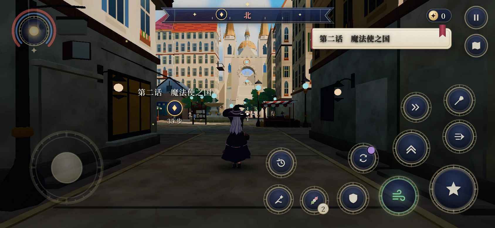

手机和平板请横屏。左半屏是摇杆，右半屏拖动转视角，右侧的按钮会随着步行、骑帚、战斗和手艺切换。按钮大小、浓淡和拖动视角的速度可以在设置里调。手机默认用专为手机准备的画质档。

## 常用操作

| 动作 | 键鼠 |
| --- | --- |
| 移动、转动视角 | W A S D、鼠标 |
| 调查或交谈、推进对白 | E、Enter |
| 召唤或收起扫帚 | F |
| 骑帚时上升、下降、加速 | 空格、C、Shift |
| 步行时跳跃、疾跑 | 空格、Shift |
| 选择魔法 | 数字键，或按住 Tab 打开轮盘 |
| 施法 | 鼠标右键；学会二阶后按住蓄力再松开 |
| 魔力弹 | 鼠标左键（按住连发） |
| 闪身、防护 | Q、R（按住 R 举盾，法术飞到时举起能弹回去） |
| 对波 | 对方的光束打来时按住 R 迎上去，再连点左键 |
| 锁定 | 鼠标中键或 T |
| 吃面包 | X |
| 手记、地图、魔法簿、暂停 | J、M、B、Esc |
| 攀爬 | 走向岩壁或墙面就会抓住；空格向上一跃，Q 松手 |
| 滑坡 | 顺着陡坡跑时按住 C |
| 游泳 | Shift 快游，Q 划一大把，F 唤出扫帚离开水面；贴水面飞时按住 C 扎进水里 |
| 牵星线（学会后） | Z 取出星线，左键牵住或放下；滚轮推远拉近，按住 R 动鼠标转动；贴着别的木头放下会系上星结，右键解开 |
| 溯光（学会后） | G 点亮，对准坏掉的东西按左键 |

## 本地运行

需要 Node.js 22.12 或更新版本，以及支持 WebGL 2 的桌面浏览器。

```sh
git clone https://github.com/shoal-rat/majo-no-tabitabi.git
cd majo-no-tabitabi
npm ci
npm run serve
```

打开 `http://127.0.0.1:8751/`。第一次启动会在本机生成地形数据。开发服务器会在每次刷新页面时重新构建。存档跟着浏览器和地址走，下次请用同一个。

普通入口会按设备选择画质档位，帧率下降时自动降低渲染分辨率。想固定下来，可以加参数：`?quality=low`、`med` 或 `high`，再加 `dynres=0` 关掉分辨率调整。`http://127.0.0.1:8751/?quality=high&dynres=0` 能把云影、水面倒影和掠水尾流看得最清楚。

## 构建与打包

`npm run release` 会把静态版本输出到 `dist/`，把整个目录放到任意静态服务器上即可。

在 macOS 上还可以打包成 Electron 应用。完成上面的 `npm ci` 后，安装桌面端依赖再打包：

```sh
npm ci --prefix desktop
npm run package:mac
```

打包脚本会启动一次成品做检查，应用位于 `release/魔女之旅-darwin-<架构>/魔女之旅.app`。

## 想改什么，从哪里开始

游戏用 JavaScript、Three.js 和 Rapier 写成。主文档是 [docs/JOURNEY.md](docs/JOURNEY.md)，里面有地图、各系统的规则和验收方法。玩家能看到的文字一律放在 `src/locales/zh-CN/`，不写进代码。

| 想修改的内容 | 从这里开始 |
| --- | --- |
| 主线步骤和完成条件 | [src/story/questdefs.js](src/story/questdefs.js) |
| 对白和任务说明 | [src/locales/zh-CN/story.dlg.main.js](src/locales/zh-CN/story.dlg.main.js) · [story.quests.js](src/locales/zh-CN/story.quests.js) |
| 芙兰的试炼和战斗教学 | [src/story/fran-spar.js](src/story/fran-spar.js) · [spar-lessons.js](src/story/spar-lessons.js) |
| 第一次用得上时的手记提醒 | [src/gameplay/onboarding.js](src/gameplay/onboarding.js) |
| 路线、主路和剧情锚点 | [src/data/journey-map.js](src/data/journey-map.js) |
| 分话登记（章节、国家、印章） | [src/data/episodes.js](src/data/episodes.js)，加一话的步骤见 [docs/api/ui.md](docs/api/ui.md) 的「Adding an episode」 |
| 魔法使之国与城市生活 | [src/data/bellcrown.js](src/data/bellcrown.js)（`CITY_LIFE`）· [src/world/builders/mage-city.js](src/world/builders/mage-city.js) · [src/world/life/](src/world/life/) |
| 地标、迷星、机关、飞行环线 | [src/data/landmarks.js](src/data/landmarks.js) · [src/data/wilds.js](src/data/wilds.js) · [src/gameplay/wilds.js](src/gameplay/wilds.js) |
| 残页试炼 | [src/gameplay/wilds-pages.js](src/gameplay/wilds-pages.js) · `src/data/wilds.js` 的 `PAGE_SITES` |
| 元素、组合与法术融合 | [src/elements/](src/elements/) · [src/spells/fusions.js](src/spells/fusions.js) |
| 魔物与战斗节奏 | [src/combat/](src/combat/) · [src/combat/pacing.js](src/combat/pacing.js) |
| 攀爬、游泳与气力 | [src/player/climb.js](src/player/climb.js) · [src/player/stamina.js](src/player/stamina.js) |
| 牵星线、结星、溯光 | [src/craft/](src/craft/) · [src/data/craft.js](src/data/craft.js)（能牵的部件、修复地点、数值）· [src/locales/zh-CN/craft.js](src/locales/zh-CN/craft.js) |
| 地形破坏与恢复 | [src/world/destruction.js](src/world/destruction.js) |
| 配乐 | [tools/music/](tools/music/README.md)：乐谱在 `cues/`，`node tools/music/render.mjs <曲名>` 渲染 |
| 雕出来的模型 | [tools/sculpt/](tools/sculpt/README.md)：用形状代码生成带 LOD 的 GLB。游戏地址加 `?sculpt=0` 看替换前的旧物件，`?sculpt=all` 打开全部，`?sculpt=类型,类型` 只开这几种 |
| 色调、太阳、天空、天气 | [src/render/post.js](src/render/post.js)（`GRADES`、`LOOKS`）· [src/world/sky.js](src/world/sky.js) · [src/world/journey-weather.js](src/world/journey-weather.js) |
| 衣装 | [src/data/outfits.js](src/data/outfits.js) · [src/ui/wardrobe.js](src/ui/wardrobe.js) |
| 触屏操作 | [src/ui/touch.js](src/ui/touch.js) |

## 验收

改动玩法之后，用本机的 Chrome、Chromium 或 Edge 跑下面的验收（浏览器装在别处时，把 `CHROME_BIN` 指向它）。它们使用一次性的无头浏览器档案，不会碰你的存档。

```sh
node tools/acceptance/journey-story.mjs          # 两话主线、真实读档、芙兰试炼的两种结局、片尾名单、重温对练
node tools/acceptance/journey-flight.mjs         # 横穿地图：天气、太阳、风车、玩家炸出的坑经过存档往返
node tools/acceptance/journey-cloud-weather.mjs  # 沿天气锋面的云量变化，按存档时间重现
node tools/acceptance/journey-cloud-flight.mjs   # 骑扫帚钻进一朵白天的云，回头往下看，再降进云里
node tools/acceptance/journey-city-clouds.mjs    # 城墙被云遮住又重新出现，云隙光
node tools/acceptance/journey-eclipse.mjs        # 渡湖日食和水面倒影
node tools/acceptance/journey-activities.mjs     # 每类机关都用真实法术解开，拾迷星，飞一条环线，六处残页试炼，存档往返
node tools/acceptance/journey-errands.mjs        # 五个路边委托走完对话、飞行与施法，途中存档往返
node tools/acceptance/broom-wake.mjs             # 不开浏览器：扫帚的飞行受力和尾流
node tools/acceptance/meadow-wake.mjs            # 不开浏览器：花田里压出的草痕和卷起的花瓣
node tools/acceptance/pressure-waves.mjs         # 不开浏览器：水面的尾流和波纹
node tools/check-i18n.mjs src                    # 代码里没有写死玩家可见的文字
node tools/dead-code.mjs                         # 列出没被打包进游戏的源文件
```

`node tools/play.mjs --name x --script f.js [--mobile --size 844x390]` 可以无头运行游戏、执行自己的脚本、截图和模拟触屏。本页的 GIF 都是用 [tools/trailer/capture.mjs](tools/trailer/README.md) 从游戏里逐帧录下来的，镜头脚本在 [tools/trailer/shots/readme/](tools/trailer/shots/readme/)。

## 反馈与贡献

遇到卡关、穿模、光影或性能问题，欢迎到置顶的 **[问题反馈专帖 #7](https://github.com/shoal-rat/majo-no-tabitabi/issues/7)** 留言，复杂的问题也可以用「问题反馈」模板另开一帖。请写上当前的手记目标、所在地点、触发步骤、浏览器和画质档位；画面问题最好附一张游戏内截图。

想动手改东西，流程是：先用 Proposal 模板发一个议题，写清楚想改什么、玩家会看到什么、会不会缩短旅途或降低难度；再在议题下评论 `/claim` 认领；然后从自己的分支发 Pull Request，第一行写 `Closes #议题号`。每个 PR 都会自动构建游戏、检查角色模型和认领状态。完整的规则见 [CONTRIBUTING.md](CONTRIBUTING.md)。用 AI 代理参与开发时，请先让它读 [AGENTS.md](AGENTS.md)，里面有不能改动的约定和必须运行的检查。

## 开源与素材

项目原创的程序以 [MIT 许可](LICENSE) 开放，可以学习、修改、分发，也可以商业使用。

《魔女之旅》的作品名、角色和原作设定归各自权利人所有。游戏素材沿用各自的许可：第三方素材只用 CC0 或 CC-BY，字体用 OFL；为本项目生成或雕出的美术和 CC0 素材不另要求署名。背景音乐是本项目的原创配乐。扫帚掠过草地和水面留下的痕迹、扬起的花瓣与水花，做法改编自 [Petalwake](https://github.com/jjcm/petalwake)（MIT）。作者、来源与许可集中写在 [CREDITS.md](CREDITS.md)，逐项清单见 [assets/manifest.json](assets/manifest.json)，再分发时请一并保留。
