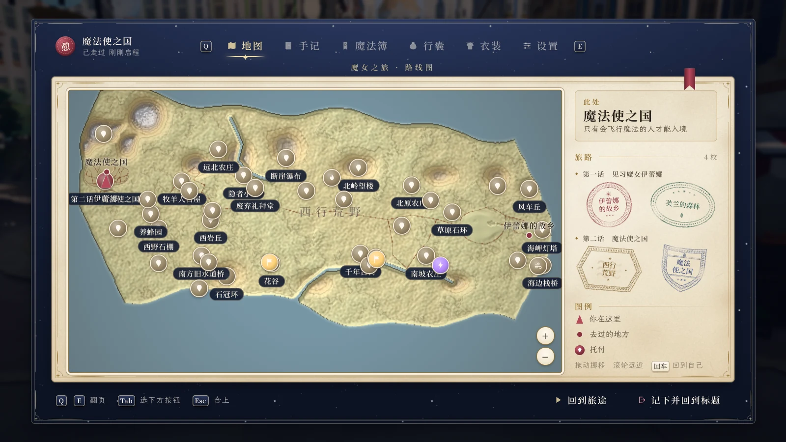

[English](README.en.md)

# 魔女之旅 · 骑帚旅行


扮演伊蕾娜，从故乡的书桌出发，到森林里向芙兰学魔法，再骑扫帚一路向西，直到魔法使之国从原野上升起。这款免费的第三人称同人游戏改编自动画前两话，对白为游戏重新编写。整段旅程是一张连在一起的大地图，普通巡航从东飞到西大约五分钟。

**[在浏览器开始旅行](https://weikezhang.cn/majo-no-tabitabi/)** · 简体中文 · 电脑用键鼠，手机和平板横屏触屏。第一次打开需要下载游戏资源，进度保存在当前浏览器。选择「踏上旅途」，走到书桌前按 **E** 翻开旅行记。

本项目是爱好者制作的非官方、非营利同人游戏，与原作权利方没有关系。

## 2.0 版新内容

- **原创配乐**：13 首新曲贯穿两条主题旋律，循环无缝；战斗、Boss、对决会随着敌人多少叠上更激烈的声部。
- **旅行手记风格的界面**：入境印章、日记体旁白、护照印章地图、带环形计量的徽章，为以后扩展到十二话预留了数据结构。
- **更耐打、更好看的战斗**：敌人出招前有起手动作，完美闪避和防御之后可以反击，架势打崩会硬直，残血会背水一战；精英、试炼守护者和芙兰的重温比试分阶段，熟练的人也要打上几分钟。
- **在战斗里学战斗**：芙兰的第一次比试就是战斗教学，对波、弹反和二阶元素组合在第一处残页试炼里学；其余操作由伊蕾娜的手记在第一次用得上时提醒。
- **魔法分阶**：一开始只会一阶魔法，二阶在野外六处「残页试炼」里解开机关、打败守护者才能学会。
- **爬山与游泳**：岩壁、悬崖和房子外墙都能爬，水里能游，体力环统一管理攀爬、游泳、疾跑和滑翔。
- **牵星线与溯光**：用魔法砍倒树木，用星线搬起木头、转动、系成木筏再挂帆；溯光能让倒下的树站起来、碎石合拢、烧焦的地面返青。
- **手工雕琢的世界**：魔法使之国的屋顶、窗户、城门、集市、大教堂和五种房型，城里的炊烟、晾衣绳、猫和鸽子；故乡的房屋、野外的石头和风车、各处地标、试炼场、魔物和路人都重新雕过。
- **扫帚尾迹**：低飞会在花田压出一条慢慢恢复的痕迹，卷起花瓣和草叶，湖面溅起水花；金光只在加速时出现。巡航 15 米/秒、加速 26 米/秒，俯冲能换来速度。

## 两话的行程

- **第一话 · 见习魔女伊蕾娜**　从故乡走到森林小屋拜师，在空地上练风魔法，然后是芙兰的试炼：盯住她的杖尖，在魔法弹飞到面前的一瞬间举盾，就能把它弹回去。之后是授名、胸针，和母亲道别。
- **第二话 · 魔法使之国**　向西渡过星痕湖，穿过旷野、翻过高山口，从南城门的拱洞飞进城。在屋顶撞见沙耶，修好屋瓦，找到旅馆，再带她练习穿过三道飞行环。城门道别之后是尾声和片尾名单；通关后地图照样可以自由飞，也可以回林间空地找芙兰再比一场。

芙兰的陨石、它砸出的湖，以及西行渡湖时的日食，是这次改编新加的情节。


## 可以做些什么

### 像动画里那样斗法


施法时杖尖和脚下会展开一层层魔法阵，看准时机举盾会炸开星芒、把对方的法术原样弹回，决定胜负的瞬间还会短暂放慢。芙兰的第一次比试就是战斗教学，通关后重温时会多出更难的第四阶段。东部草原的魔物不多，西行荒野和高山口有营地、五个具名精英，还有骑扫帚从空中偷袭的人。荒原狼、泥沼团、隘口石卫、余烬蛇、霜角鹿和盗贼魔法使各有各的打法：元素护盾只怕克制它的元素，架势条可以打崩，每一招过后都有破绽可抓。

### 把元素组合起来


规则只有三条：元素改变物质，元素改变元素，物质之间不会直接起反应。雷打进水洼会让它带电，冰把它冻成冰面，火把它烧成蒸汽云，岩把它搅成泥沼。自己的法术还能融合：火打进自己的龙卷变成炎旋，雷劈进雨云变成朝下方敌人落雷的雷雨云，冰打进去就下起冰雹。29 种组合，第一次发现时都会记进手记的「元素笔记」。

### 大地记得你做过什么


火和雷会炸出焦坑，岩柱会顶起土丘，陨石砸出陨坑，树木朝爆炸的反方向倒下。这些痕迹都写进存档，下次回来还在。大地按游戏时间慢慢长好：焦痕大约四分钟褪去，草两分半到六分钟长回来，烧焦的树八分钟后重新发芽，倒下的树二十分钟后从树桩里冒出树苗，三十分钟长成大树。坑会一直留着，坑底慢慢长出草来。城镇、故乡和剧情地点不会被破坏。

### 飞进垂直的魔法使之国


城市铺满了整座高台，城墙脚下缭绕着一圈薄雾。城门拱洞高 22.5 米，城门塔高 92 米。街道是高楼夹出的幽暗峡谷，生活都在高处：近千个露台、屋顶平台和廊桥都能落脚，天上满是魔女，在露台之间来回跳、顺着空中航道成群飞过、绕着尖塔盘旋。城中央抬高的内城上是带玫瑰窗的大教堂。修好屋瓦之后，旅馆柜台可以用星屑买面包和成长道具。

### 在旷野里发现东西


原野上有 47 处原创地标，排布让人骑帚时每隔几秒就有新东西进入视野。48 颗「迷星」在塔顶、风车帽、桥洞下和最高的山顶上一闪一闪，每拾到 6 颗就有奖励，还会浮现一句「漏星魔女的手记」。17 处地标机关只能用元素规则解开：点燃烽火台，烧掉荆棘，炸开落石，冻住水潭留住漂走的匣子，淋湿十三块立石再用一道雷全部点亮，三阵风吹转风车桩，用火暖起天灯再骑帚追上它。三条飞行环线按成绩发奖章，石堆和瞭望点会把附近的迷星标在地图上。找到的一切都记在地图和手记的「旅途见闻」页。

<p>
  
  
</p>

### 换衣服


「衣装」页有四套衣服：日常服、魔女服和两套水着。日常服和魔女服在授名之后可以自由挑选。伊蕾娜在第一话里只有十四五岁，所以两套水着要等两话都通关才开放。剧情进行时，由剧情决定她穿什么。

### 光与天气


默认是柔和通透的色调：收住过饱和的颜色，阴影微微抬起，远处是淡淡的蓝。设置里可以切回原来鲜艳的色调。太阳压得比较低，影子拉得长，侧光偏暖。一路上大约三成时间晴，四成是晴天积云，两成多云，一成阵雨；云影从山坡上掠过，云隙间落下光柱。慢动作、镜头切换和闪屏这类演出效果，以及画面震动，都可以在设置里分别关掉。

### 用手机玩


手机和平板请横屏。左半屏是移动摇杆，右半屏拖动转视角，右侧的按钮会随着步行、骑帚和战斗切换。按钮大小、透明度和视角速度可以在设置里调。手机默认使用低画质档。

## 常用操作

| 动作 | 键鼠 |
| --- | --- |
| 移动、转动视角 | W A S D、鼠标 |
| 调查或交谈、推进对白 | E、Enter |
| 召唤或收起扫帚 | F |
| 骑帚时上升、下降、加速 | 空格、C、Shift |
| 步行时跳跃、疾跑 | 空格、Shift |
| 选择魔法 | 数字键，或按住 Tab 打开轮盘 |
| 施法 | 鼠标右键；学会大式后按住蓄力再松开 |
| 魔力弹 | 鼠标左键（按住连发） |
| 闪身、防护 | Q、R（按住 R 举盾，法术飞到时举起能弹回去） |
| 锁定 | 鼠标中键或 T |
| 吃面包 | X |
| 手记、地图、魔法簿、暂停 | J、M、B、Esc |
| 攀爬 | 贴上岩壁或墙面就会抓住；空格向上一跃，C 松手 |
| 游泳 | Shift 快游，Q 划一大把；F 唤出扫帚离开水面 |
| 牵星线（学会后） | Z 取出星线，左键牵住或放下；贴着别的木头放下会系上星结，右键解开 |
| 溯光（学会后） | G 点亮，对准坏掉的东西按左键 |

## 本地运行

需要 Node.js 22.12 或更新版本，以及支持 WebGL 2 的桌面浏览器。

```sh
git clone https://github.com/shoal-rat/majo-no-tabitabi.git
cd majo-no-tabitabi
npm ci
npm run serve
```

打开 `http://127.0.0.1:8751/`。第一次启动会在本机生成地形数据。开发服务器会在每次刷新页面时重新构建。存档跟着浏览器和地址走，下次请用同一个。

普通入口会按设备选择画质档位，帧率下降时自动降低渲染分辨率。想固定下来，可以加参数：`?quality=low`、`med` 或 `high`，再加 `dynres=0` 关掉分辨率调整。`http://127.0.0.1:8751/?quality=high&dynres=0` 能把云影、水面倒影和掠水尾流看得最清楚。

## 构建与打包

`npm run release` 会把静态版本输出到 `dist/`，把整个目录放到任意静态服务器上即可。

在 macOS 上还可以打包成 Electron 应用。完成上面的 `npm ci` 后，安装桌面端依赖再打包：

```sh
npm ci --prefix desktop
npm run package:mac
```

打包脚本会启动一次成品做检查，应用位于 `release/魔女之旅-darwin-<架构>/魔女之旅.app`。

## 想改什么，从哪里开始

游戏用 JavaScript、Three.js 和 Rapier 写成。主文档是 [docs/JOURNEY.md](docs/JOURNEY.md)，里面有地图、各系统的规则和验收方法。玩家能看到的文字一律放在 `src/locales/zh-CN/`，不写进代码。

| 想修改的内容 | 从这里开始 |
| --- | --- |
| 主线步骤和完成条件 | [src/story/questdefs.js](src/story/questdefs.js) |
| 对白和任务说明 | [src/locales/zh-CN/story.dlg.main.js](src/locales/zh-CN/story.dlg.main.js) · [story.quests.js](src/locales/zh-CN/story.quests.js) |
| 芙兰的试炼和陨石 | [src/story/fran-spar.js](src/story/fran-spar.js) · [fran-meteor.js](src/story/fran-meteor.js) |
| 路线、主路和剧情锚点 | [src/data/journey-map.js](src/data/journey-map.js) |
| 魔法使之国与城市生活 | [src/data/bellcrown.js](src/data/bellcrown.js)（`CITY_LIFE`）· [src/world/builders/mage-city.js](src/world/builders/mage-city.js) · [bellcrown.js](src/world/builders/bellcrown.js) · [src/world/life/](src/world/life/) |
| 地标 | [src/data/landmarks.js](src/data/landmarks.js) |
| 迷星、机关、飞行环线 | [src/data/wilds.js](src/data/wilds.js) · [src/gameplay/wilds.js](src/gameplay/wilds.js) |
| 元素、组合与法术融合 | [src/elements/](src/elements/) · [src/spells/fusions.js](src/spells/fusions.js) |
| 魔物与战斗 | [src/combat/](src/combat/) |
| 斗法特效与魔法阵 | [src/fx/duel.js](src/fx/duel.js) · [src/fx/circles.js](src/fx/circles.js) |
| 地形破坏与恢复 | [src/world/destruction.js](src/world/destruction.js) |
| 色调、太阳、天空 | [src/render/post.js](src/render/post.js)（`GRADES`、`LOOKS`）· [src/world/sky.js](src/world/sky.js) · [src/world/veil.js](src/world/veil.js) |
| 天气与云 | [src/world/journey-weather.js](src/world/journey-weather.js) · [src/render/cloud-field.js](src/render/cloud-field.js) |
| 衣装 | [src/data/outfits.js](src/data/outfits.js) · [src/ui/wardrobe.js](src/ui/wardrobe.js) |
| 触屏操作 | [src/ui/touch.js](src/ui/touch.js) |

## 验收

改动玩法之后，用本机的 Chrome、Chromium 或 Edge 跑下面的验收（浏览器装在别处时，把 `CHROME_BIN` 指向它）。它们使用一次性的无头浏览器档案，不会碰你的存档。

```sh
node tools/acceptance/journey-story.mjs          # 两话主线、真实读档、芙兰试炼的两种结局、片尾名单、重温对练
node tools/acceptance/journey-flight.mjs         # 横穿地图：天气、太阳、风车、玩家炸出的坑经过存档往返
node tools/acceptance/journey-cloud-weather.mjs  # 沿天气锋面的云量变化，按存档时间重现
node tools/acceptance/journey-city-clouds.mjs    # 城墙被云遮住又重新出现，云隙光
node tools/acceptance/journey-eclipse.mjs        # 渡湖日食和水面倒影
node tools/acceptance/journey-activities.mjs     # 每类机关都用真实法术解开，拾迷星，飞一条环线，存档往返
node tools/acceptance/journey-errands.mjs        # 五个路边委托走完对话、飞行与施法，途中存档往返
node tools/check-i18n.mjs src                    # 代码里没有写死玩家可见的文字
node tools/dead-code.mjs                         # 列出没被打包进游戏的源文件
```

`node tools/play.mjs --name x --script f.js [--mobile --size 844x390]` 可以无头运行游戏、执行自己的脚本、截图和模拟触屏。本页的 GIF 都是用 [tools/trailer/capture.mjs](tools/trailer/README.md) 从游戏里逐帧录下来的，镜头脚本在 [tools/trailer/shots/readme/](tools/trailer/shots/readme/)。

## 反馈与贡献

遇到卡关、穿模、光影或性能问题，欢迎到置顶的 **[问题反馈专帖 #7](https://github.com/shoal-rat/majo-no-tabitabi/issues/7)** 留言，复杂的问题也可以用「问题反馈」模板另开一帖。请写上当前的手记目标、所在地点、触发步骤、浏览器和画质档位；画面问题最好附一张截图。

想动手改东西？先发议题、评论 `/claim` 认领，再开 PR，流程见 [CONTRIBUTING.md](CONTRIBUTING.md)。

提交修改请从自己的分支发起 Pull Request，每个 PR 都会自动构建游戏并检查角色模型。用 AI 代理参与开发时，请先让它读 [AGENTS.md](AGENTS.md)，里面有不能改动的约定和必须运行的检查。

## 开源与素材

项目原创的程序以 [MIT 许可](LICENSE) 开放，可以学习、修改、分发，也可以商业使用。

《魔女之旅》的作品名、角色和原作设定归各自权利人所有。游戏素材沿用各自的许可；为本项目生成的美术和 CC0 素材不另要求署名。第三方模型、音乐、音效和字体的作者、来源与许可集中写在 [CREDITS.md](CREDITS.md)，逐项清单见 [assets/manifest.json](assets/manifest.json)，再分发时请一并保留。
