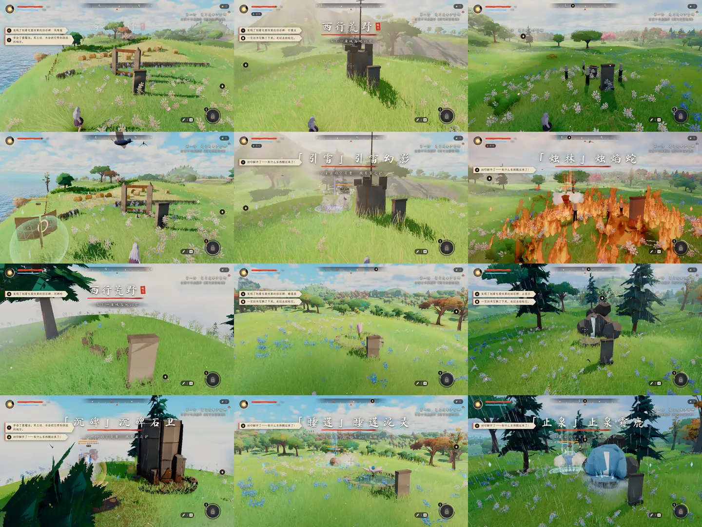

# *Wandering Witch* fan game: design and maintenance guide

This is the game's **main document**. Working rules for AI agents are in [AGENTS.md](../AGENTS.md) at the repository root; player feedback is collected in [Issue #7](https://github.com/shoal-rat/majo-no-tabitabi/issues/7). The repository was forked from the *Moonveil Miko* engine. `docs/DESIGN.md` and the earlier sections of `docs/api/*.md` describe that game (shrines, the Moonveil, shades, the eight-element spirit charms) and serve only as engine reference; where they conflict, this document wins. Interface details for each system are still in `docs/api/<system>.md`; the "as built / round" sections at the end of each file are new for this game.

## 1. Iron rules

1. **Player-visible text never goes in code.** All of it lives in `src/locales/zh-CN/<namespace>.js` and is read with `t()` / `raw()`; file names start with the owning system (`ui.touch.js`, `combat.js`, `elements.js` …). Keys are written as placeholders such as `{guard}` and `{cast}`; `fill()` / `G.input.keyLabel()` show the key name on a computer and the button name on a phone. `node tools/check-i18n.mjs src` must pass before delivery.
2. **Saves stay backward-compatible.** The save key `majo_no_tabitabi_episodes_save_v1` never changes; every new persistent field gets a default in `defaultState()` / `defaultSettings()` in `src/core/save.js`; when story progress changes, old saves must be backfilled (see the backfill in `story.js start()`).
3. **Tests never touch the player's save.** Use only `tools/play.mjs` and `tools/acceptance/*` (throwaway headless browser profiles; `autostart=1` writes no save). Do not test in a regular browser, the built-in browser, on port 47327 or in the desktop build.
4. **Originality and references.** Official anime stills are private reference only, kept in a private folder outside the repository; they never enter the repository and are never published. Dialogue, monsters, landmarks and levels are original to this game. You may borrow *Breath of the Wild*'s design **methods** (the triangle rule, gravity, the three rules of the chemistry engine), but not its content, names or looks.
5. **Performance tiers.** New content scales its counts with `G.quality` (`low/med/high`); static geometry is merged (`bakeStatic` / chunked baking), repeated objects are instanced, and distant ones switch to low-poly models or are culled. Phones default to `mobile` (handheld: at least 1080 lines and 30 fps; under load it first trims scenery, then drops to 900 / 720 lines; the setting 「保持 1080」 (Keep 1080) locks it).
6. **All cross-system access uses optional chaining** (`G.fx?.burst(...)`); `update()` never throws and never allocates objects every frame.

## 2. Map and story

- Coordinates: X and Z each span ±2450 m, +X is east, −Z is north, sea level is y=0. The route runs east to west: hometown (2220,50) → Fran's forest and the forest trial ground (2055..2100) → Starscar Lake (1725,−48) → east grassland (1340,−110) → western wilds (180,−208) → high pass (−1235,−286) → City of Magic (−2160,−520). The main road `ROAD_ACROSS` and the story anchors `JOURNEY_ANCHORS` are both in `src/data/journey-map.js`.
- Quests: `src/story/questdefs.js` (episode 1 `apprentice`, episode 2 `mages`); dialogue is in `src/locales/zh-CN/story*.js`. After the farewell at the city gate, episode 2 plays the epilogue and the end credits (`G.ui.showEnding`; credits content in `ui.credits`). Their 「制作」 (Production) section lists Director: Shoal_Rat, github.com/shoal-rat, and Claude Opus 5.5, Claude Fable 5.2, ChatGPT 5.2 Astra; do not delete or alter it.
- Episodes and countries: `src/data/episodes.js` is the one registry every out-of-play UI surface reads (journal chapters, the
  map page's travel stamps, country title cards, procedural stamp art in `src/ui/stamps.js`). The plan is 12+ episodes: a new
  one is data there + its locale text + its quest, never UI code. Steps, fields and the 12-episode probe
  (`tools/journey/episodes-probe.js`): `docs/api/ui.md` "Adding an episode".
- Elements unlock with the story, small forms only: wind after reading the book; water, fire and ice after Fran's confession; thunder and earth at the naming (`invest`). Fran never teaches the charged (tier-2) forms: each one is won at its page trial in the open country (§5, 「残页试炼」). Saves never lose a level; old saves that already hold charged forms keep them.
- Landmarks: `src/data/landmarks.js` lists the map's 47 original landmarks (id, type, scale large/medium/small, coordinates, `affords` ways to interact). Placement follows the triangle rule and "gravity": targets of different sizes pull the player from different directions, so on the broom something new comes into view every 4–5 seconds; `node tools/journey/poi-coverage.mjs` produces a coverage heat map.

## 3. City of Magic (the vertical city)

The design core of the city: **tall buildings, a tall gate, dim street canyons below, life up high; hopping between balconies on the broom is both the easiest and the best-looking way to get around.**
- Buildings: `src/world/builders/mage-city.js`, `bellcrown.js`; data in `src/data/bellcrown.js`. The gate arch is 22.5 m high and the gate towers 92 m; the inner city is raised 16 m and holds the cathedral with its rose window. About 1000 balconies, rooftop landing pads and footbridges you can land on are real platforms (`G.world.addPlatform`).
- `CITY_LIFE` (exported from `src/data/bellcrown.js`, also attached at `G.structures.places.landOfMages.life`) provides coordinates for spires, balconies, street centre lines, plazas, sky lanes, no-go zones and more, used by city life (flying witches and crowds, `src/world/life/city-*`).
- Street-canyon light: `mvCanyonSky()` in `veilhook` keeps only about 1/3 of the skylight low in the city and restores it at balcony height; plazas stay open. Parameters are in `world/sky.js` (`U.mvCanyon*`).
- Story points (gate crossing, rooftop collision, tile mending, inn, practice field) must always stay usable; after changing the city layout, run `journey-story.mjs` and `journey-city-clouds.mjs`.
- The inn counter has a small shop (`SHOPS.city_shop`, opens once the roof tiles are mended) that sells bread and four growth items for stardust.

## 4. Visuals

- **Colour look**: setting `look`: `soft` (default; modelled on the clear grading of anime-style games: restrained high saturation, low contrast, lifted cool shadows, highlights held below paper white, light-blue aerial perspective) and `vivid` (the original). Presets are `GRADES` / `LOOKS` in `src/render/post.js`, blended every frame by `world/sky.js`. The grass blade material stays at 100% of its original colour (chosen by the author in PR #2/#3).
- **Light ratio and sun**: the everyday sun path peaks at about 50° at noon (`veil.js DAY_ARC`), with long slanting shadows and warm side light in the morning and afternoon; the story sun of the eclipse over the lake is unaffected. `LOOKS.soft.key/fill` set the ratio of sunlight to skylight; cloud-gap light shafts `shafts` are capped so backlight never washes the whole screen out to white.
- **Weather**: `world/journey-weather.js`. Along the route, time splits roughly into 30% clear, 40% clear with cumulus, 20% cloudy, 10% showers. Cumulus is driven mainly by 330 m billowing noise (`cloudVolume.js`), with grey-blue cloud bases; cloud-shadow edges are tightened (`cloud-shafts.js mvCloudSunAt`).
- **Cinematic camera**: setting `cinematic` (slow motion, camera cuts, screen flashes); `shake` controls camera shake.

## 5. Gameplay systems

- **Elements** (`src/elements/`, `docs/api/elements.md` "Element weaving"): the three rules of the chemistry engine: elements change materials, elements change elements, materials never change materials directly. Ground element zones (puddles, electrified puddles, ice sheets, steam clouds, mud, frost ground, lava), 29 combinations and spell fusions (fire tornado, thunderstorm cloud, hail, great wave …); first discoveries are recorded in `G.state.elementNotes` and shown on the journal's 「元素笔记」 (Element Notes) page.
- **Combat** (`src/combat/`, `docs/api/combat.md`): no enemies spawn in the hometown or the city; the east grassland is light, while the western wilds and the high pass have camps, elites (5 named ones, each recorded once defeated) and aerial ambushes; every enemy type needs a different answer (elemental wards break only to the countering element, posture gauges, openings). Fights are built to last and to trade blows (`src/combat/pacing.js`, combat.md "Longer fights"): a foe that has begun a telegraphed attack finishes it unless it is staggered, shocked or frozen; staggers come from weaving elements and reactions, and one that lands mid-wind-up interrupts the move; a dodge through a blow or a guard raised just in time opens the attacker; below 40 % hp (elites 50 %) a foe rallies once and fights faster. Ordinary foes take about 2–3 times as long as before; named elites, the page-trial guardians and Fran's spar longer still. Fran's first sparring match is also the combat tutorial: inside the bout she teaches lock-on, dodging, the guard, counter-attacks, answering a spell with its element, element weaving and staggers on a stardust wolf, reading a pounce, rallies and wind against a rider, one short line and task at a time (`src/story/spar-lessons.js`; skippable with {interact}); no other combat tutorial screen exists. Everything else (sprint, the broom and its mana, healing, the respawn, the spell wheel, element chemistry in the world, the map, journal, page trials, ring courses, shop, wardrobe and the touch look) is taught the same way, in context and by doing, by the journal's notes (`src/gameplay/onboarding.js`, `docs/api/gameplay.md` "Onboarding round"). The recollection after clearing is a re-challenge with a fourth movement of chained spells (2–3 min for a competent player); the forest clearing also has a stardust trial.
- **Terrain destruction** (`src/world/destruction.js`, `docs/api/terrain.md` "Destruction round"): craters, uplifts, fallen trees, rubble and broken walls are all saved; `G.world.carveGuard()` protects towns, the hometown and story anchors. **Recovery** (by `playTime`): scorch marks fade in about 4 minutes, grass grows back in 2.5–6 minutes, burned trees regrow new leaves over 4 minutes after 8 minutes, fallen trees sprout a sapling after 20 minutes that is full-grown at 30; the crater itself remains, and grass slowly grows on the crater floor after 10 minutes.
- **Effects and duel staging** (`src/fx/circles.js`, `src/fx/duel.js`): casting magic circles, comet trails, honeycomb guard and starburst, slow-motion beats, duel framing.
- **Phones** (`src/ui/touch.js`, `docs/api/ui.md` "Touch and small screens"): left stick, drag on the right to look, buttons that change with state; actions are injected through `G.input.virtual`, and gameplay code reads only actions, never raw key codes.
- **Wardrobe** (`src/data/outfits.js`, `src/ui/wardrobe.js`, `docs/api/heroine.md` "Wardrobe (journey)"): four outfits: everyday clothes, witch's robe, Tide Festival swimsuit and Dusk Sea swimsuit. Elaina is only fourteen or fifteen in episode 1, so the two swimsuits open only after both episodes are finished (`majo_finished`); the everyday clothes and the witch's robe can be chosen freely after the naming (`majo_named`). While either episode is in progress, the story decides the outfit (everyday clothes in episode 1, the witch's robe in episode 2) and switches back to it on load and before every story beat, so cutscenes never show the wrong outfit; after clearing, the player's choice is kept on load and the story no longer changes it. The swimsuit models are generated by `node tools/journey/swimwear.mjs` from the original engine's two swimsuits (with Elaina's hairstyle and eye colour swapped in); the wardrobe pictures are reshot with `node tools/costume/wardrobe-pics.mjs`.
- **Wilds exploration** (`src/gameplay/wilds*.js`, data `src/data/wilds.js`, text `gameplay.wilds.*`, `docs/api/gameplay.md` "Activities round"): borrows *Breath of the Wild*'s methods; the content is original.
  - **Stray stars**: 48 (39 hang on landmarks: tower tops, windmill caps, under bridges, inside stone shelters, at well mouths; 9 on the highest peaks of each region), twinkling from afar (one point sprite each, one draw call); touch one to collect it, from the broom too. Every 6 bring a reward and reveal a line from 「漏星魔女的手记」 (Notes of the Star-Spilling Witch); stars 12/24/36/48 each grant one growth level.
  - **Landmarks**: on first approach the name pops up (a banner for large landmarks) and is recorded on the map and the journal's 「旅途见闻」 (Travel Sights) page (tallying places, stray stars and chests in each of 6 regions). Cairns offer 「添一块石头」 (Add a stone); high points (watchtowers, lighthouses, castle tops, aqueducts) automatically mark nearby stray stars on the map.
  - **Puzzles** (17, solved only by element rules): lighting (beacon baskets, lighthouse lamps), burning brambles, shattering rockfalls with thunder or earth, freezing a pool to hold a drifting chest in place, putting out embers with water or ice, wetting thirteen standing stones and then running one bolt of thunder through them all, turning windmill posts with three gusts of wind, lighting a sky lantern and chasing it. State is stored in `G.state.wilds.puzzles`; frozen water and sky lanterns that have flown off are physical state and not saved; just do them again.
  - **Flight ring courses**: 3 (cape, ancient tree, south valley); the timer starts when you pass the first ring, and medals and best times are stored in `G.state.wilds.rings`. Medal times were calibrated by the acceptance script's autopilot at cruising speed.
  - **Economy**: exploration gives about 2400 stardust and 6 free growth levels; `UPGRADES` prices were lowered, so a player who explores thoroughly reaches about level 15/20 on a first playthrough.
  - None of this enters the protected zones of the city, the hometown or story anchors, and none of it touches story steps; acceptance: `node tools/acceptance/journey-activities.mjs` (`ACT_RINGS=all` flies all three ring courses).
- **Page trials 「残页试炼」 (tier-2 spells)** (`src/gameplay/wilds-pages.js`, data `PAGE_SITES` in `src/data/wilds.js`, text `gameplay.wilds.pages.*`, guardian plates `combat.enemy.pg_*` / `combat.elite.pg_*`, `docs/api/gameplay.md` "Page trials round"). Design note: the witch starts with small forms only and has to explore to grow; the owner wants progression gated behind exploration, never handed out. Fran's line at the naming sets it up: long ago a witch tore the charged chapter out of her grimoire and left one page where each element is strongest. One site per discovery region, east to west along the road: 风琴崖 wind (coast headland), 引雷丘 thunder (a south-moor knoll), 烛林空地 fire (a glade north of the wilds), 沉碑岭 earth (a crag summit north of the pass), 睡莲泉 water (a vale meadow), 止泉石 ice (the west woodland).
  - Each site is a marker stone with the element's sigil (a coloured glint pulls from about a kilometre; sighted within 85 m → map pin in the element's colour and a journal note with the stone's riddle) beside a mechanism that answers only that element's **small** form, by the element system's own rules: wind sings through a stone harp, lightning goes to an iron rod, fire lights five candles, a rock pillar lifts a sunken lectern, water wakes a dry lily bud, ice stops a falling spring.
  - The seal answers only a named witch (`majo_named`); an apprentice sees the sigil flicker and go dark. Opening it wakes the guardian: a circle blooms, the element's motes gather, then a burst, a flash, a slow beat, a camera angle and a banner with its name. Guardians are elites built on combat types (pages, a lightning mage, an ember snake, a stone guard, a mud spirit, a frost stag), each with a ward of the site's element that only the countering element breaks; a toast gives the trick (freeze the wind, ground the lightning, douse the fire, split the stone, don't water the mud, melt the frost). Leaving the arena (60 m) or falling puts it back to sleep; it wakes again when she returns.
  - Beating it drops the page; touching it teaches level 2 of that element with the learn ceremony (a page whose form she already knows pays 160 stardust). State `G.state.wilds.pages[id]` = `seen` | `open` | `won` | `read`; the fight itself is not saved. Guardian numbers (`hpMul`, affixes) are data for combat tuning. Acceptance: part 3 of `node tools/acceptance/journey-activities.mjs` (screenshots `page-site-*`, `page-guardian-*`, `page-ceremony-fire`, `page-map`).
  - 
  - Nothing in the story needs a charged form: Fran's spar comes before the naming and has answers in the four small forms she has then; episode 2 has no fights; the clearing trial's wards break to small forms of their counters; wilds puzzles and errands all accept small forms.
- **Roadside errands** (`src/gameplay/errands*.js`, data `src/data/errands.js`, text and dialogue `gameplay.errands.*`, `docs/api/gameplay.md` "Errands round"): five short stories of travellers: deliver a letter by broom and bring back the reply, chase a hat blown away by the wind (wind magic can scoop it back), light a shepherd's stove with fire, freeze the shallows under a broken bridge so a pumpkin cart can cross the river, and read the stray-star notes aloud to the witch at the roadside shrine outside the city. They appear only once you have a broom and give way when the current main-quest objective is within 220 m; state is stored in `G.state.errands`; an errand in progress takes over the HUD objective bar, and the journal's 「旅途见闻」 page has a section for them. The dirt track on the practice meadow is a ring path in `ROADS` (`PRACTICE_TRACK`), with its props in `world/builders/practice-field.js`; acceptance: `node tools/acceptance/journey-errands.mjs`.

- **Movement and craft (design, 2026-11-24; built in four PRs: movement → creation → restoration → integration)**.
  The owner asked for a BotW-inspired movement layer (climbing, swimming) and a creation layer (felling, traction,
  binding, restoration). We borrow *methods* only: a stamina budget that turns every wall into a question ("can I make
  it?"), any surface you can see you can climb, physics objects as building parts, and undoing time on one object. Names,
  looks and UI are original and fit 魔女之旅: a witch who mends and gathers with thread and light.
  - **Stamina 「气力」** (`src/player/stamina.js`, numbers in its `STAMINA` table): a gold petal ring (twelve petals,
    `src/ui/stamina.js`) by her shoulder that only shows while it is not full. 100 points (+20 per growth level
    `upgrades.stamina`). Sprint 7/s, climb 9/s moving and 1.5/s holding still, climb jump 20, fast swim 11/s, swim stroke
    (dodge in water) 16, slow swim 2/s, glide 4/s. It refills at 32/s after 0.6 s on firm ground (in the swim/climb/glide
    states it never refills). At zero she is **winded**: the ring turns rose and must refill completely before sprint,
    climb, fast swim or glide work again; on a wall she slips off, in deep water she sinks and the water brings her back to
    the last bank she stood on (8 damage, like falling out of the world). The broom costs no stamina (it costs mana) and
    can be called from the water, so the broom is always the way out.
  - **Climbing** (`src/player/climb.js`): she grabs any wall she walks, jumps or glides into: terrain steeper than she
    can walk (cliffs, crags, the high pass), rock outcrops and any solid collider at least 0.9 m across (house and city
    walls, towers, boulders, bridge piers). Detection is collider-based (`G.world.collidersNear` + terrain slope), never a
    per-mesh tag, so re-sculpted buildings climb as long as they register their walls. Climb speed 1.5 m/s up, 1.8 m/s
    sideways, 2.4 m/s down (slower than walking and far slower than the broom, which stays the fast way up). Climb jump
    (jump on the wall) leaps 2 m in the held direction. At a top she mantles onto the ledge (`ClimbUp_1m`); a wall whose
    top has nothing to stand on (a pitched roof above the eaves) leaves her hanging at the eave, so in the City of Magic the
    places to stand stay the balconies, pads and footbridges, and the broom stays the way between them. Ladders (colliders
    with `climb: 'ladder'`) cost no stamina. Rain makes rock slick: climbing costs 1.5× in a shower. Pose: the rig's hand
    IK (`rig.reach`) and a new foot reach put hands and feet on the wall in an alternating rhythm over a held base pose.
  - **Jumps onto ledges and slides**: a jump at a ledge up to 2.1 m above her feet vaults onto it (no stamina). Slopes
    steeper than she can walk slide her down along the fall line with the slide pose and she can steer and jump off;
    holding {descend} while running downhill on a slope over 17° starts the same slide on purpose (gains speed, free).
  - **Swimming**: slow swim on the surface; holding {sprint} swims fast (stamina); {dodge} is a stroke burst. She climbs
    out at banks (a bank up to 1.2 m above the water is a mantle). From the broom: {broom} over deep water drops her into a
    dive (no fall damage into deep water, a deep splash, she surfaces); the broom no longer has to stop to set her down.
  - **Creation** (`src/craft/`, `docs/api/craft.md`): attack magic fells trees into physics logs (the destruction system
    already fells; small thunder and earth fell too, so it works from episode 1). **「牵星线」 (star thread)** is the
    traction art: a fine gold thread from her wand catches a loose physics object (logs, planks, crates, barrels, ladders,
    sails, felled-tree logs; mass under 600), carries it in 3D along her aim (wheel / two buttons pull it in and push it
    out), and turns it (hold {guard} and move the mouse, or the turn buttons on a phone) to set its pose. When the held
    part touches another loose part, tiny four-pointed **star knots 「结星」** glint at the contact; letting go there ties
    them with a fixed joint (Rapier multibody joints: no drift, a log raft stays square) and the knots keep glowing faintly.
    {cast} while holding a tied part snips its knots. Assemblies float (bridges, ramps, rafts); a **sail** part catches
    the element system's wind (`G.elements.windAt`, her own gusts, tornado edges), so a raft with a sail sails when she
    blows wind into it. Caps by quality: parts per assembly mobile 8 / low 10 / med 16 / high 24, tied bodies alive
    mobile 24 / low 32 / med 48 / high 64; past the cap the knots refuse with a toast.
  - **Restoration 「溯光」 (back-light)**: aim at something damaged and its history runs backwards in a silver-blue light
    with a ring of tick marks: logs fly back into the trunk and the tree stands up, shards close into the rock, scorch
    drains out of the ground and the grass stands again, a crater's earth flows back in, a broken bridge's planks fly home
    and lock, a dropped prop rises back onto its shelf. History comes from what is already recorded: wreck records
    (`G.flora.wreck`), burn cells and scar stamps (destruction), broken props (`prop:broken`), and a short ring buffer of
    transforms for craft parts and set-piece pieces (`src/craft/history.js`). Restored world damage leaves the save (the
    record is dropped); natural regrowth (destruction "Recovery") keeps running unchanged for everything she does not
    restore. Costs mana (20 + size), one target at a time, 1.6–3 s per rewind.
  - **Learning** (data `CRAFT_LEARN` in `src/data/craft.js`, evaluated on every load so old saves catch up):
    climbing and swimming are hers from the start (first-use hints); **牵星线** is Fran's: once the chores beat
    (`apprentice.chores`) is done she shows that a witch carries firewood on a thread (first log near the cottage);
    **溯光** comes in the City of Magic with the roof-tile mending (`mages.repair`): putting the tiles back taught her the
    shape of it. Each is taught BotW-style on first use: a short toast with the key, then a small place where it is the
    only way forward (a log over a ravine east of the lake; a fallen footbridge to a balcony in the city).
  - **Wilds and errands** (integration PR): data-driven craft sites in `src/data/wilds.js` (`CRAFT_SITES`: gap bridges,
    log ramps to a ledge, a raft crossing with a sail, broken bridges and statues to restore) and two errands; every site
    also accepts the broom or climbing where that is honest (exploration rewards stay as they are). The 12-episode plan:
    each future country adds sites as data with `episode` set; no system code per country.

## 6. Acceptance and maintenance tools

| Command | What it checks |
| --- | --- |
| `node tools/acceptance/journey-story.mjs` | Main story of both episodes, save loading, sparring outcomes, end credits, sparring rematch |
| `node tools/acceptance/journey-flight.mjs` | Crossing the map, weather, sun, windmills, save round trip of player-made craters |
| `node tools/acceptance/journey-cloud-weather.mjs` | Cloud-cover changes and their reproduction from the saved time |
| `node tools/acceptance/journey-city-clouds.mjs` | City walls hidden by cloud and reappearing, cloud-gap light |
| `node tools/acceptance/journey-eclipse.mjs` | The eclipse while crossing the lake, and reflections on the water |
| `node tools/acceptance/journey-activities.mjs` | Wilds exploration: eight kinds of puzzles solved with real spells, collecting stray stars, cairns, flying one ring course, save round trip, screenshots of the map and journal pages; the six page trials (asleep seal, small-form seals, guardians and their wards, a real fight at the wind site, recede and re-wake, page → level 2 with the ceremony, a known page, a page left lying across a save round trip) |
| `node tools/acceptance/journey-errands.mjs` | Roadside errands: all five completed end to end (dialogue, letter-delivery flight, hat chase, lighting the fire, freezing the river, stray stars), with two save round trips along the way |
| `node tools/check-i18n.mjs src` | No hard-coded Chinese in the code |
| `node tools/dead-code.mjs` | Lists source files not bundled into the game (for clearing out engine leftovers) |
| `node tools/play.mjs --name x --script f.js [--mobile]` | Headless runs, screenshots, touch simulation |
| `node tools/play.mjs --name pacing --quality low --timeout 3000 --script tools/journey/fight-pacing.js` | Times every foe type, five camps and the five named elites with a scripted player at two growth levels (time to kill, hits taken, foe attacks, staggers) |
| `node tools/play.mjs --name spar --quality low --timeout 900 --script tools/journey/spar-pacing.js` | Times Fran's forest bout with a scripted duellist |

Cleanup principle: engine leftovers this game does not use are deleted outright (22 removed on 2026-11-22: the old shrine/village/Thousand-Lantern Town/palace and other building generators, the old companion and cutscenes, the coast and floating-island terrain); data with old-map coordinates (`ANCHORS` etc. in `src/data/world.js`) is still referenced by the engine's lower layers, so confirm the callers before changing it.
